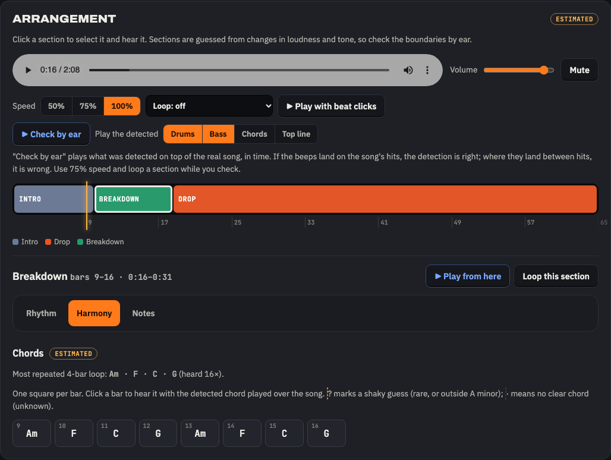

# Teardown

**Upload a track and see how it is built.**

Teardown listens to an audio file in your browser and tells you what it can work out about how the track is constructed: tempo and whether it stays steady, key, the arrangement as sections on a bar-numbered timeline, the drum pattern and chords of each section, and what can be measured in the sound (level, dynamics, stereo width, where the energy sits). You can play any section, loop it, slow it down, and play the detected parts over the real song to check them by ear. When something is wrong you correct it, and you can take the timing, the notes and the analysis data into any DAW.

Everything runs in the browser. The audio is analyzed locally and is never uploaded anywhere. There are no accounts.



## What it does

1. **Analyze.** Tempo (with half and double as possibilities), key (with the keys it could also be), meter (assumed 4/4), the arrangement, and the measured sound: level, peak, crest factor, stereo width and energy by frequency band.
2. **Explore.** The arrangement timeline is the centre of the page. Click a section to select it, hear it and see its rhythm, harmony and rough notes. The player loops, slows down, clicks the tracked beats, and plays the detected drums, bass, chords and top line over the song.
3. **Correct.** Change the tempo (×2, ÷2 or type it), move bar 1 by a beat, say the track isn't in 4/4, or change the key, a bar's chord or a drum step. Everything is recorded with its original value. A tempo or bar-1 correction analyses the track again from the same audio at that value, so the result is a fresh analysis; without the audio (a saved teardown) what depends on it is marked out of date and not exported, never shown as valid.
4. **Export.** Analysis data (.json) always. The MIDI parts and the song lined up to bar 1 only when the bar grid can be trusted: they are locked until you check the bar lines with the beat clicks, and refused when the tempo changes or drifts or after you corrected the tempo.

Every finding says how it is known: **measured** (computed from the audio), **estimated** (inferred: listen, check, correct), **assumed** (not detected, like four beats per bar) or **unknown** (the analyzer can't tell, and says so). It does not give style or mood guesses, mixing advice or plugin recommendations: nothing here has been validated well enough to claim it.

## How accurate is it?

**We have not measured accuracy on real music yet.** The only numbers so far come from `tests/benchmark.js`, which runs the analyzer on 6 computer-generated songs where the right answer is known: pop, trap, house, swing, a melodic song and a fast-808 song. The tempo and beat rows also use 2 copies of the pop song with silence added at the start.

These songs have a constant tempo, start on the beat and repeat the same bars. The analyzer was also tuned on them. So these are **regression checks** (they catch changes that make things worse), not a measure of how well the app does on real tracks.

| Part | Result | How it's scored |
|---|---|---|
| Tempo | 8/8 within ±4 % | BPM vs the true tempo |
| Beats | F-measure 0.994 | Tracked beat times vs true beat times, ±70 ms |
| Downbeats (bar 1) | F-measure 0.978 | Same, for the first beat of each bar |
| Key, exactly right | **4/6** | Tonic and major/minor must both match. The two misses named the relative key (C major for A minor, A major for F# minor). Counting "same notes" as correct would give 6/6, which is how earlier versions of this page got that number. |
| Chords | 213/213 bars | One major/minor triad per bar; the test songs only use one triad per bar |
| Kick | precision 0.94, recall 0.98 | Position on the 16-step grid, bar by bar (not timing in seconds) |
| Snare / clap | precision 1.00, recall 0.98 | Same |
| Hi-hats | precision 1.00, recall 0.93 | Same |
| Hook onsets | precision 0.94, recall 1.00 | One song only (17 of 17 notes found, 1 extra) |
| 808 / bass | **not measured** | No benchmark scores it yet. Earlier versions of this page listed numbers here that no script produces. |

*Precision: when it says there's a hit, there is one. Recall: it found the hits that are really there. F-measure combines the two (1.0 = perfect).*

The drum scores check *which* 16th-note steps have a hit, not *when* the hit lands, so they can't catch a timing error. Real mixes, with reverb, layered samples, vocals and tempo drift, are harder. Treat the output as a first draft and check it by ear; the app has tools for exactly that.

Every benchmark run saves a full record to `tests/out/` and fails if any score drops below the floors in `tests/benchmark-gates.json`. Those floors are the measured values above, not targets. The method and its known weaknesses are in `docs/TECHNICAL_AUDIT_2026-11-16.md`.

### How the detection works (short version)

- **Tempo and beats:** spectral-flux onsets, autocorrelation for tempo, then dynamic-programming beat tracking that follows small tempo drift while the drum pattern is read. Chords, sections and the exported MIDI then use one fixed tempo for the whole song, in 4/4.
- **Kick:** low-band onsets. An 808 note with no kick on it is filtered out by checking for the kick's 2–5 kHz click, but only when a song clearly has both kinds of low hits.
- **Snare / clap:** sustained broadband noise after the hit, measured in the *quiet gaps between harmonics*, so synth notes, chord changes and kick clicks don't count.
- **Hats:** high-band onsets, a later window for swung 16ths, and hats hidden under a snare decided from the hats around them.
- **808 / bass:** low-end onsets at 16th-note resolution, and each note's pitch read from the whole time it rings, skipping the attack.
- **Key:** chroma correlated with two key profiles, plus bass evidence, then checked against the detected chords (which chords fit, which chord the song keeps returning to).

## Run it

The app is a Svelte 5 + Vite + TypeScript application in `app/` (see `docs/SVELTE_MIGRATION.md`). Its analysis comes from framework-free modules in `src/` (`engine.js`, `domain.js`, `timemap.js`, `timing-store.js`). The earlier single-file page (`index.html`) uses the same modules; it is kept as the benchmark harness's reference page and is published at `/legacy.html` for one release.

```bash
npm ci --prefix app
npm --prefix app run dev          # http://127.0.0.1:5174, local only
npm run app:build                 # app/dist/production (the site) and app/dist/bench (with test hooks)
```

`npm run dev` serves the legacy page at http://localhost:5173, plus the compiled app under `/app/dist/`. It serves only those, `docs/`, `test-songs/` and `tests/samples/`, and only to this computer. Saved teardowns are kept in this browser only.

## Tests

```bash
npm install
npx playwright install chromium
npm run songs        # makes the synthetic test songs (needs Python 3 + numpy)
npm test             # metric tests, dev-server security tests, then the feature tests
npm run benchmark    # scorecard on the synthetic songs; fails below tests/benchmark-gates.json
```

GitHub Actions runs all of this on every pull request (`.github/workflows/ci.yml`). A fast stage (type check, unit tests, a production build and a fast smoke test, a few minutes) runs first, and the longer jobs only start when it passes. `npm run ci:local` runs the same stages in the same order on your machine (`npm run ci:local -- --fast` for the fast stage only).

| File | What it checks |
|---|---|
| `npm run app:unit` | Unit tests (Vitest) for the app's own modules: saving (full, without beats when storage is nearly full, never damaging earlier saves), storage helpers, the timeline grid and position maths, the shared viewport |
| `npm run test:unit` | The Node unit tests that need no generated audio: metrics, TimeMap, timing store, MIDI export and timing, transcription, the benchmark scorers |
| `npm run smoke:fast` | The production build starts, loads every asset, shows the empty page and analyses a short generated click track, with no errors |
| `npm run e2e:journey` | The critical journey through the page only, on the production build: upload, analyse, confirm the bar lines, export MIDI and analysis data, save, reload, reopen. CI runs it in Chromium, Firefox and WebKit (`TT_BROWSER`) |
| `npm run smoke:live` | Read-only check of the deployed site: it loads, every asset loads, a generated click track analyses, and nothing is requested from other sites. Run by hand (or the manual "Live smoke" workflow) |
| `tests/benchmark.js` | Scorecard against synthetic songs with known answers, with regression floors (`tests/benchmark-gates.json`) |
| `tests/metrics.test.js` | The scoring code itself, on hand-made cases |
| `tests/dev-server.test.js` | `npm run dev` never serves git history, packages, dotfiles or other local files |
| `npm run app:parity` | The app and the legacy page give identical predictions, tracked grid and exported note times on every benchmark track |
| `npm run app:product-tests` | The app's behaviour: stale jobs, cancel, input limits, bars and loops on the tracked grid, section times, saved timing, export gating, labels, the timeline, volume, no removed features, nothing leaving the browser |
| `npm run app:data-tests` | Saved data is read both ways between the legacy page and the app on the same origin; saved records with missing fields still open |
| `npm run app:smoke` | The app in the Vite dev server and both builds, desktop and phone |
| `tests/test*.js` | The legacy page's own browser tests (it still ships as the benchmark reference) |

## Habits this project follows

- **Measure before and after.** Every detection change is run against the scorecard, and CI fails if a score drops. "Feels more accurate" isn't evidence.
- **Realistic test data.** The first synthetic hi-hats were full-range noise and would have steered the snare fixes wrong, so the test drums were rebuilt to sound like real ones.
- **Change one thing, then re-run everything.**
- **Check on real screens**, desktop and phone, scrolled and unscrolled.

## Limits

- The hook and bass transcriptions are rough on dense mixes. Use them as a starting point, not the answer.
- Relative keys (like A minor and C major) share the same notes, so the app may name either one. It did on 2 of the 6 test songs.
- Tempo and bars: one fixed tempo per song, 4/4 only. Songs that speed up, slow down or change meter will drift off the grid.
- A beat right at 0:00 is currently missed by the beat tracker (the bar-1 position is still found).
- Saved teardowns don't keep the audio. Re-upload the song for listening tools and the lined-up WAV.

## Credits

Built by Ethan Goodwin with Claude (Anthropic).
