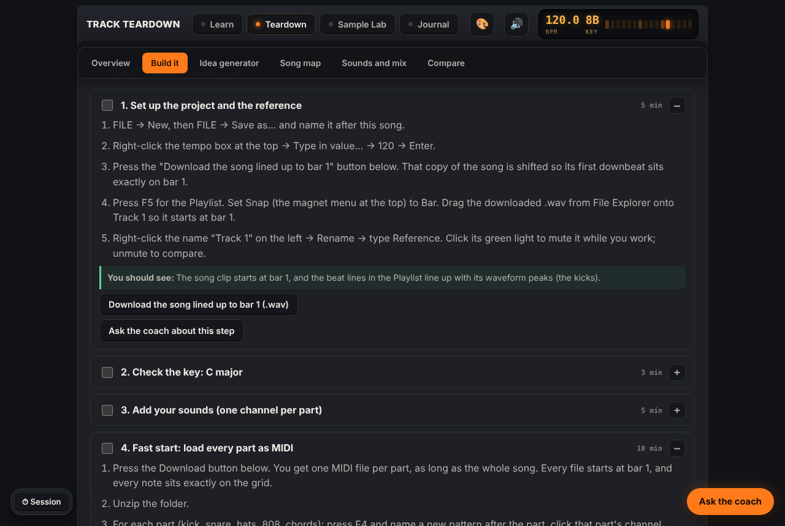

# Track Teardown

**Upload a song, get a step-by-step plan to rebuild it in FL Studio.**

Track Teardown listens to an MP3 in your browser and works out the tempo, key, song sections, drum pattern, chords, 808/bass line and a rough hook. It then turns that into a 13-step Build-it plan with MIDI you can import straight into FL Studio's Piano roll. It's a learning tool for producers: you study how a song is made by rebuilding it yourself, then make something original.

Everything runs in one HTML file. The audio is analyzed locally in the browser and is never uploaded anywhere.



## What it does

| Tab | What you get |
|---|---|
| **Overview** | Tempo, key (with a "play the key" ear check), mood, energy and a quick read of the mix |
| **Build it** | A step-by-step FL Studio plan (Piano roll and Playlist only), with a MIDI picture and a download for every part, warnings when a detection looks shaky, and a 25-minute session timer |
| **Song map** | Arrangement timeline lined up with the audio, bar ruler, loop/slow-down tools, "Check by ear" (synth plays the detected parts over the song), bar-by-bar chord grid |
| **Idea generator** | Original drum, 808, chord and melody ideas in the song's key and tempo, exportable as MIDI |
| **Sounds and mix** | Which samples and plugins suit the style, and mix moves |
| **Compare** | Upload your version and get a closeness score (tempo, key, drums, mix) |

Plus a **Sample Lab** (sort and tag your sample folders), a **Journal** (practice log and habits), a **Learn** tab with ear training, and a **Display** menu (text size, spacing, accent color).

## Exports that line up in FL Studio

- **Full-song MIDI per part** (kick, snare, hats, 808, chords, hook): every file starts at bar 1, and every note sits on the 16th-note grid.
- **The reference song, lined up**: a WAV copy of the song, padded or trimmed so its first downbeat lands exactly on bar 1. Drop it on Track 1 at bar 1, and the MIDI matches it.

## How accurate is it?

`tests/benchmark.js` runs the analyzer on synthetic songs where the right answer is known (pop, trap, house, swing, a melodic song and a fast-808 song) and prints a scorecard.

| Part | Precision | Recall |
|---|---|---|
| Kick | 0.94 | 0.98 |
| Snare / clap | 1.00 | 0.98 |
| Hi-hats | 1.00 | 0.93 |
| Chords | 1.00 | 1.00 |
| Key (correct notes) | 6/6 | |
| Hook onsets | 0.94 | 1.00 |
| 808 / bass onsets | 0.91 | 0.71 |

*Precision = when it says there's a hit, there is one. Recall = it found the hits that are really there.*

These are synthetic songs. Real mixes, with reverb, layered samples and vocals, are harder, so treat the output as a strong first draft and check it by ear. The app has tools for exactly that.

### How the detection works (short version)

- **Tempo and beats:** spectral-flux onsets, autocorrelation for tempo, then dynamic-programming beat tracking so the grid follows small tempo drift.
- **Kick:** low-band onsets. An 808 note with no kick on it is filtered out by checking for the kick's 2–5 kHz click, but only when a song clearly has both kinds of low hits.
- **Snare / clap:** sustained broadband noise after the hit, measured in the *quiet gaps between harmonics*, so synth notes, chord changes and kick clicks don't count.
- **Hats:** high-band onsets, a later window for swung 16ths, and hats hidden under a snare decided from the hats around them.
- **808 / bass:** low-end onsets at 16th-note resolution, and each note's pitch read from the whole time it rings, skipping the attack.
- **Key:** chroma correlated with two key profiles, plus bass evidence, then checked against the detected chords (which chords fit, which chord the song keeps returning to).

## Run it

Open `index.html` in a browser. That's it.

When it runs as a Claude artifact, saved teardowns, the journal and progress sync to your Claude account. On its own it falls back to your browser's local storage.

## Tests

```bash
npm install
npx playwright install chromium
npm run songs        # makes the synthetic test songs (needs Python 3 + numpy)
npm run benchmark    # accuracy scorecard
npm test             # feature tests (no page errors, downloads work, plan renders, ...)
```

| File | What it checks |
|---|---|
| `tests/benchmark.js` | Accuracy scorecard against songs with known answers |
| `tests/test21.js` | MIDI and the reference WAV start exactly on bar 1 |
| `tests/test22.js` | Build-it plan: step order, MIDI pictures, warnings |
| `tests/test23.js` | Chord grid and click-to-hear |
| others | Sample Lab, idea generator, overlay, stems, the 8 coaching features, volume |

## Habits this project follows

- **Measure before and after.** Every detection change is run against the scorecard. "Feels more accurate" isn't evidence.
- **Realistic test data.** The first synthetic hi-hats were full-range noise and would have steered the snare fixes wrong, so the test drums were rebuilt to sound like real ones.
- **Change one thing, then re-run everything.**
- **Check on real screens**, desktop and phone, scrolled and unscrolled.

## Limits

- The hook and bass transcriptions are rough on dense mixes. Use them as a starting point, not the answer.
- Relative keys (like A minor and C major) share the same notes, so the app may name either one.
- Saved teardowns don't keep the audio. Re-upload the song for listening tools and the lined-up WAV.

## Credits

Built by Ethan Goodwin with Claude (Anthropic), as a way to learn music production by taking songs apart.
