# Svelte 5 migration: plan, M0 baseline and M1 record

Status: **v1 product focus applied (§14).** The Svelte app is now one view that answers one question: what can Track Teardown tell a producer, accurately, about how an uploaded track is built. The earlier feature-complete port (§13) was cut back accordingly. The analysis algorithms, Version A, benchmark thresholds, TimeMap and all benchmark infrastructure are unchanged. Production changes only when PR #18 is merged: that is the founder's decision (§9).

| | |
|---|---|
| Migration source commit | `b2f05513b81787cfbc93632db98d1014fd2224ba` (`origin/main`, merge of PR #16, 2026-11-17) |
| `index.html` at that commit | 411,107 bytes, 3,702 lines, sha256 `416e8d4fee9700576d816ff818ce85c14de7fd96e85f42369dd11f6a6ec3a970` (differs from Version A's `a14fea96…` because of the reliability and Phase 2c step 1 PRs; the analysis output is unchanged, see §5) |
| Version A (never modified) | tag `analyzer-baseline-a` → `07b9012e5e1236137cb49d3d7bbc18554c06be6e` (`docs/BASELINE_A.md`) |
| Branch | `migration/svelte5`, worked in a separate git worktree so the main checkout (used by other sessions) was not switched |
| Roadmap note | `docs/ROADMAP.md` §5 lists "Framework migration (React/Svelte/Next/TypeScript)" as *rejected for this assignment*. The founder approved the Svelte 5 migration on 2026-11-18 (§0); the roadmap row is updated by whoever next edits `docs/ROADMAP.md` (roadmap PR #17 is open on the same file, so this branch does not touch it). |

**Rule for everything below.** A *migration regression* is a difference between the Svelte app and the legacy app on the same input. An *existing defect* is something the legacy app already does wrong (listed in §8 with its source). **Analysis results** must match the legacy engine exactly: analysis defects are reproduced faithfully and fixed only by separately reviewed analysis PRs, measured against Version A. **Interface defects** (clipped navigation, controls covering content on phones, mid-word breaks) do not have to be reproduced (founder, 2026-11-18): the new app preserves functionality, not layout bugs. No accuracy claim is made here beyond the synthetic benchmark evidence in §5, which is regression evidence, not real-music accuracy. **No Svelte analyzer parity is claimed until the Svelte app actually executes the extracted analysis engine** (M3).

## 0. Founder decisions (2026-11-18, after M0 review)

| Question | Decision |
|---|---|
| Approve M1? | Yes, with the amendments below. |
| Continue Phase 2c in legacy? | **Yes.** Analysis development is not interrupted. The Svelte app synchronises with it periodically; M2 (engine extraction) is done in a short integration window agreed with the analysis workstream. |
| Export confirmation screen | **Legacy first**, with reusable, domain-level export validation logic (not UI code), so the Svelte app reuses the same validation later. Owned by the analysis/Phase 2c workstream, not this branch. |
| UI SDK beta | **Adopt**, pinned to the tested versions, with API dependencies isolated. TTdown owns its design system and audio-specific components; UI SDK is an implementation detail behind `app/src/lib/ui/`. |
| Single-file Claude artifact | **Not a requirement.** The new app is a conventional multi-file Vite build (room for Web Workers, WebAssembly, lazy-loaded analysis, independently cached assets, larger models). A single-file build may be an optional experiment later. |

| Amendment | What it means here |
|---|---|
| Default view | **Teardown** is the default destination of the new app (empty or unknown hash). Learn, Sample Lab and Journal stay reachable as secondary views. |
| Runtime integrations | Claude integrations (`db`, `user`, `downloads`, `sample`, `dictation`) stay optional. Their absence must not block cutover. |
| Build provenance | Hashes of the compiled assets are computed **externally**, after the build (`app/scripts/build-manifest.mjs`). The bundle embeds only source facts (commit, versions, TimeMap source hash), never a hash of itself. |
| Reactive state | `$state.raw` results are never mutated in place: corrections apply by **explicit replacement** (a new result object) or a revision counter, because nested mutations of raw state do not trigger updates. |
| Test hooks | Compatible hooks exist in the **bench/test build only**. Production builds do not expose decoded audio buffers or analysis internals through globals. |
| Audio | The global `AudioContext` monkey-patch (volume) is **replaced** by explicit audio ownership (one audio service that owns contexts and gain routing) when playback migrates, under behaviour tests equivalent to the legacy volume tests. |
| Storage | Matching keys is not enough: bidirectional compatibility is verified **on the same origin**. Different preview or deployment domains have separate storage, so the cutover plan must say which origin the users' data lives on. |


---

## 1. Sources read

`README.md`, `docs/ROADMAP.md` (and the open roadmap PR #17 diff), `docs/TECHNICAL_AUDIT_2026-11-16.md`, `docs/BASELINE_A.md`, `docs/TIMEMAP.md`, `docs/TIME_FIXTURES_BASELINE.md`, `bench/README.md`, `.github/workflows/ci.yml`, `scripts/dev-server.js`, `scripts/sync-timemap.js`, `bench/run.js`, `tests/run-tests.js`, every `tests/test*.js` header, and `index.html` (inventory by structured search of every storage key, runtime call, global, hash and heading, plus reading the shell, analysis entry, storage, history, routing, volume and display code; not every line of the ~2,300 lines of UI was read).

Open PRs (`gh pr list`, 2026-11-17): #17 roadmap (open), #4 G1-H harness (draft, superseded by #6), #3 Claude Code workspace (draft), #1 product strategy docs (draft). This PR is #18.

---

## 2. Application inventory (legacy `index.html` at the source commit)

### 2.1 Structure of the file

| Lines | Block | Notes |
|---|---|---|
| 1–326 | CSS | Design tokens as CSS variables (`--fs`, `--accent`, `--lcd`, `--hdr`, …); dark "console" look; `prefers-reduced-motion` honoured |
| 328–388 | Page shell | Header (brand, 4 nav links, Display, Volume, LCD readout), four `view-*` containers, upload card, history, `#out` |
| 389–825 | `<script>` 1: **TimeMap** | Inlined copy of `src/timemap.js` between `/* BEGIN src/timemap.js … */` and `/* END src/timemap.js */`. Exposes global `TimeMap`. Kept identical by `npm run sync:timemap`; `tests/timemap-sync.test.js` fails on drift |
| 826–3700 | `<script>` 2: everything else, one IIFE closure | See below |
| 829–850 | Volume | Wraps `window.AudioContext` / `webkitAudioContext` in a subclass that routes `destination` through a gain node (one volume for every sound the app makes) |
| 851–1366 | **Analysis engine** (DSP, `transcribe`, `analyze`) | Almost DOM-free: only `probeDuration()` creates an `<audio>` element; decoding uses `OfflineAudioContext`. Writes `window.__analysisStats`. Runs on the main thread with `await tick()` checkpoints (cancellable via `AbortSignal`) |
| 1367–1444 | Teaching rules | Genre guesses, plugin/sample advice |
| 1445–2128 | Rendering, Build-it plan, Idea generator, MIDI + zip writer | Hand-rolled `el()` DOM builder; `render(a, opts)` builds the teardown; `applyTabs()` groups sections into tabs **by matching `<h2>` text** |
| 2129–2248 | Whole-song notes, aligned WAV, Check by ear | `songNotes(a)` (exported MIDI timing), WAV padded/trimmed to bar 1, overlay synth |
| 2249–2379 | Progress, journal, habits, ear training, chord checker, review page | |
| 2380–2513 | Card folding, accuracy checklist + stems, player tools (speed, loop, solo band) | |
| 2514–2668 | Transcription view, samples that fit, compare band chart, library matches, share, session timer | |
| 2669–3104 | Samples to grab, key check, chord grid, retempo/setKey corrections, TimeMap grid adapter (`gridOf`), pattern playback, Compare, Coach | |
| 3105–3320 | Sample Lab | Per-sample analysis (`analyzeSample`), shelf |
| 3321–3575 | Learn FL Studio | Missions, shortcuts, FL coach, practice log |
| 3576–3699 | History, upload wiring (job tokens, cancel, object-URL ownership), example teardown, router, volume UI, sticky header, Display settings, boot | |

### 2.2 Top-level views (hash routes)

| Hash | View | Default | Contents |
|---|---|---|---|
| `#learn` (also empty or unknown hash) | Learn | **yes**: `route()` falls back to `learn` | FL Studio missions and progress, keyboard shortcuts, "Ask your FL Studio coach", practice log, ear training (appended by a wrapper around `renderLearn`) |
| `#teardown` | Teardown | | Upload, history, the six teardown tabs |
| `#samples` | Sample Lab | | Drop samples, per-sample analysis, filter, sample coach, shelf |
| `#journal` | Journal | | Beat journal cards per teardown, exports, notes |

`hashchange` drives both `route()` and the coach's context refresh. `location.hash = "learn"` is set programmatically from Compare ("Log this score in my practice log"). No `pushState`/`replaceState`; no query parameters.

### 2.3 Teardown tabs (`TD_TABS`, line 1451)

Tabs are buttons in `nav.tdtabs` (`aria-pressed`), not routes; the active tab is in the `tdTab` variable, reset to Overview on every new analysis. A section is assigned to a tab by `data-group` or, failing that, **by a regex on its `<h2>` text** (`applyTabs`).

| Tab (`key`) | Sections (heading as rendered) | Interactive features |
|---|---|---|
| Overview (`overview`) | "2. …" summary stats; key check by ear; "Check the results first (5 minutes)" accuracy checklist with stem uploads; "Your practice plan"; "Share with your mentor" | Play-the-key drone, set key by ear (`setKey`), BPM correction (`retempo`), stem upload rows, review page and share page downloads |
| Build it (`build`) | "3. Build it in FL Studio: step by step" | 13-step plan, per-step MIDI picture and download, step ticks (`td_plan_v1` / account `plan-*`), warnings on shaky detections, 25-minute session timer start |
| Idea generator (`ideas`) | "4. Idea generator" | Drum/808/chord/melody/vocal-chop/arrangement ideas in key and tempo, selects and sliders, playback, favourites (`idea_favs_v1` / account `idea-*`), MIDI and zip export |
| Song map (`map`) | "5. Arrangement map", "6. Chords", "7. Drum pattern", "8. Frequency balance", "What the song plays (rough transcription)" | Player with bar ruler (TimeMap), metronome, loop 4 bars, speed, solo a band, Check by ear overlay, chord grid click-to-hear, chord checker, editable 16-step drum pattern (`patternEdited`) |
| Sounds and mix (`sound`) | "9. Layers and FL Studio plugins", "10. Samples to grab", "11. EQ and mix moves", "Your samples that fit this song", "Mixes with this (from your library)" | Links into Sample Lab shelf |
| Compare (`compare`) | "12. Compare my version", "Producer habits: compare songs side by side" | Upload your version (analysed with `analyze(…, opts_compare = true)`), closeness score, fixes list, band chart, drum racks, log the score |

Global chrome: header LCD (BPM, Camelot key, LEDs), Display menu, Volume menu, practice-session pill (`.sess`), floating Coach panel, compact header on scroll, `#save-note` storage status.

### 2.4 Analysis result object (`a`)

Enumerable fields (what history, account sync, share pages and the coach see): `title, duration, bpm, bpmConf, key, camelot, keyConf, relKey, keys (top 4), pattern {kick, snare, hats, ghost?}, rhythm, sections[{label,start,end,startBar,bars}], barSec, nBars, firstDown, chords, balance, width, loudRms, crest, peakDb, bassNote, hook/bass transcriptions`, and user-correction flags `keyFixed, patternEdited`.

**Non-enumerable (must be preserved exactly):**

| Property | Defined at | Value | Why non-enumerable |
|---|---|---|---|
| `grid` | line 1360 | `{ source: "dp-tracker" \| "dp-tracker (too few beats; downbeats not chosen)", beats: number[], downbeats: number[] }` (seconds, 4 dp) | So saved history, sync, share and coach payloads are byte-identical to before the grid existed. Consequence: **a saved teardown has no `grid`**, and TimeMap falls back to a labelled constant grid |
| `__buf` | line 1363 | the decoded `AudioBuffer` (not set for compare analyses) | Lets `handle()` adopt the buffer only if the job is still current |

### 2.5 Persisted data

> **Update (cross-session message, 2026-11-18):** PR #20 adds one additive field to each `teardown_history_v1` record: `timing` (v1: tracker `beats`, `downbeats`, `meter` with provenance, and the tracker's measured `basis`), plus `timingCorrections` for user tempo corrections. Key, document ids and every other field are unchanged, and records without `timing` keep working. The tables below describe the record at the M0 source commit; §8.2 has the contract the Svelte app must follow. Until #19/#20 merge, the shape on `main` is the one below.

**localStorage** (all JSON; every read/write wrapped in try/catch via `lsGet`/`lsSet`, except volume which has its own try):

| Constant | Key | Shape | Limit / notes |
|---|---|---|---|
| `VK` | `app_volume_v1` | `{ song, sounds, muted }` | |
| `DK` | `display_v1` | `{ size: s\|m\|l, density: comfy\|compact, accent: hex, sticky: bool }` | |
| `HK` | `teardown_history_v1` | array of result objects (enumerable fields only) | 12 entries, de-duplicated by title + duration (finding C1-9) |
| `PLK` | `td_plan_v1` | `{ "plan-<tdId>": [stepIds] }` | |
| `FK` | `idea_favs_v1` | idea favourites | |
| `JK` | `beat_journal_v1` | journal entries `{ id: "jr-<tdId>", title, ref, exports[≤30], learned, … }` | |
| `EK` | `ear_training_v1` | ear-training stats | |
| `SESK` | `td_session_v1` | running session `{ start, mins, goal, ref }` or `null` | |
| `SHK` | `sample_shelf_v1` | sample shelf | |
| `PK` | `fl_campaign_v1` | mission progress map | |
| `LK` | `fl_log_v1` | practice log entries | 300 entries |

`tdId(a)` = `"td-" + slug(title)[0..40] + "-" + round(duration)`; it keys history, plans and journal entries.

**Claude account storage** (when running as a Claude artifact): `window.claude.use("db")` + `window.claude.use("user")` → collection `data/users/<uid>`, live `onSnapshot`. Document types and ids:

| `type` | Document id | Written by |
|---|---|---|
| `teardown` | `tdId(a)` | `saveHist`, `migrateLocal` |
| `plan` | `plan-<tdId>` | `setPlanDone` |
| `progress` | `progress` | `setProg`, `migrateLocal` |
| `session` | `s-<timestamp>` | `addLog` |
| `idea` | `idea-<timestamp>` | `favAdd` |
| `journal` | `jr-<tdId>` | `journalPut` |
| `sample` | `shelfId(item)` | shelf save |

States `connecting → account | local` (10 s timeout). `migrateLocal()` copies local progress, history and log into the account once. With an account, history shows up to 24 teardowns. Quota errors show "Your saved space is full…".

### 2.6 Claude-artifact runtime integrations (`window.claude.use`)

All are feature-detected; the app works without them.

| Capability | Lines | Use | Fallback |
|---|---|---|---|
| `db`, `user` | 3419 | Account storage (above) | localStorage |
| `downloads` | 2003, 2138, 2188, 2199, 2628, 2631 | `dl.save({ filename, data })` for MIDI zip, single MIDI, aligned WAV, idea zip, review page, share page | `<a download>` with an object URL revoked after 4 s |
| `sample` | 3016 (`getSample`), used at 3082, 3259, 3511 | LLM coach: `sample(prompt, { signal, onText })` streaming; teardown coach, sample coach, FL coach | "The coach isn't available in this view" |
| `dictation` | 3095 | Mic button in the coach: `start/stop/onPartial/onFinal` | mic hidden |

Privacy note (from the audit, unchanged): analysis JSON including the song title is synced and sent to the coach as prompt context; audio is never uploaded.

### 2.7 Exports

| Export | Function | Timing source today |
|---|---|---|
| Full-song MIDI per part (kick, snare, hats, 808, chords, hook), zip | `songNotes`, `midiBytes`, `zipStore` | constant `firstDown + n·barSec` grid (TimeMap step 6.5 not yet done) |
| Single-part MIDI from Build it | `midiBytes` | same |
| Reference WAV lined up to bar 1 | line 2166 | constant grid |
| Idea generator MIDI / zip | `midiBytes` | generated, tempo only |
| Review page / share page (`.html`) | `reviewHtml`, `shareData` | n/a |

### 2.8 Diagnostic and test hooks (a contract the tests and the benchmark depend on)

| Hook | Defined | Used by |
|---|---|---|
| `window.__td` | `render()` line 1482: the result on screen | `bench/run.js`, `tests/benchmark.js`, tests 17, 18, 21, 24–29 |
| `window.__sn(a)` | line 2164: `songNotes(a)` (exported note times, `stepSec`) | `bench/run.js`, `tests/benchmark.js`, test17 |
| `window.__rp(a)` | line 1753: `refreshPlan(a)` | (present; no current caller found in tests) |
| `window.__analysisStats` | line 980: `{ checkpoints, aborted }` | test26 |
| `window.__loop` | line 2487: non-enumerable getter for the active loop range | test29 |
| `window.TimeMap` | inlined script | test24, test29 |
| `result.grid`, `result.__buf` | non-enumerable (§2.4) | `bench/run.js`, `bench/score.js`, `bench/timing-consumers.js`, `bench/time-fixtures-summary.js`, tests 24, 25, 28, 29, `tests/benchmark.js` |
| `#file`, `#status` (text matching `/ready|Couldn/`), `#cancel`, `#hist button` | page shell | `bench/run.js` and almost every browser test |

The browser tests also select on ~60 other selectors and visible texts (`.tdtabs button:has-text(…)`, `section:has(h2:has-text(…))`, `#plan .pstep`, `#ideas select.isel`, `.ptools`, `.chcheck`, `.sess .stime`, `#vol-song`, `.barruler`, …). **The browser tests are coupled to the legacy DOM and copy, not to behaviour.** Only `bench/run.js` uses a small contract (`#file`, `#status`, `__td`, `__sn`, `grid`).

**All browser tests and the benchmark harness load the page from `file://`** (`bench/run.js` line 62; tests via `ROOTURL = 'file://…'`). A Vite build that emits `<script type="module" src=…>` will not run from `file://` in Chromium (module scripts are fetched with CORS). This shapes the benchmark plan in §6.

### 2.9 Corrections (user edits)

| Edit | Function | Behaviour (existing, see §8) |
|---|---|---|
| Key set by ear | `setKey` | overwrites `key`, sets `keyConf = 99`, `keyFixed = true` |
| BPM | `retempo` | overwrites `bpm`, sets `bpmConf = 99`, rescales `barSec`, `nBars`, section bars only; chords, drum grid, first downbeat not recomputed; TimeMap drops the tracked grid for a labelled fallback |
| Drum steps | pattern editor | `patternEdited = true` |

Corrections mutate the result in place and are saved via `saveHist`.

---

## 3. In-flight work that touches the same code

| Work | Where | Impact on the migration |
|---|---|---|
| **Phase 2c consumer migration onto TimeMap**: step 1 (ruler, metronome, loop) merged in #16; **step 2 (sections and arrangement) in progress in another session right now** (no branch pushed at the time of writing); then chords + chord-check loops, drum/bass event timing + overlay, MIDI + aligned-audio exports behind the three-state gate | `index.html` (`render`, `gridOf`, `songNotes`, overlay), `src/timemap.js`, `tests/timing-consumers.test.js`, `bench/baselines/version-a/consumers/` | **The largest conflict risk.** Every Phase 2c step changes exactly the timeline code the Svelte app must reproduce. The legacy app keeps moving during M1–M3, so the parity target is a moving commit (see §7) |
| **Saved-teardown timing persistence** (PRs #19 → #20, `src/timing-store.js`, `docs/PERSISTENCE.md`; not merged at the time of writing) | `saveHist`, `loadHist`, `retempo`, section rendering; new `src/timing-store.js`, `tests/timing-store.test.js`, `tests/test31.js` | Changes the saved-record shape (additive `timing`, `timingCorrections`). **The Svelte app must adopt this contract (§8.2 and parity row 6a), not the shape in §2.5 below.** Any change to the contract goes through the analysis workstream, not this branch |
| Phase 2d corrections (recompute/invalidate, no hard-coded 99) | `setKey`, `retempo`, TimeMap fingerprint | Not started. Must land in one place only; see §7 |
| Export confirmation UI (metronome audition, first-downbeat check, meter confirm) | not built | Founder decision 2026-11-18 (roadmap PR #17 §8). Building it in legacy *and* in Svelte would double the work: decide where (§11 question 3) |
| Roadmap PR #17 | `docs/ROADMAP.md` | Edits the same file the migration's roadmap row lives in; not touched here |
| Real-music pilot (Phase 1) | `bench/` | Blocked on rights and annotators. Uses `bench/run.js` → must keep working against the frozen and legacy pages (§6) |
| Draft PRs #1, #3, #4 | docs, agent workspace, superseded harness | No code overlap |

`src/timemap.js` is a classic script (no ES module) so it can be `require`d by Node tests and inlined into the page. The Svelte app must consume **the same file**, not a copy (§4.3).

---

## 4. Proposed architecture

### 4.1 Layout

```
app/                        Svelte 5 + Vite + TypeScript, own package.json and lockfile (M1: exists)
  index.html                Vite entry
  vite.config.ts            modes: development, production (dist/production), bench (dist/bench, test hooks)
  tsconfig.json, tsconfig.node.json, svelte.config.js
  scripts/                  build-manifest.mjs (external asset hashes), check-ui-boundary.mjs
  tests/smoke.mjs           browser smoke test (dev server, both builds)
  src/
    main.ts                 imports styles, installs window.__build, mounts App
    App.svelte              shell: header, nav, about-this-build popover, routes
    routes/                 Teardown (default), Learn, SampleLab, Journal (hash router)
    teardown/               Overview, BuildIt, IdeaGenerator, SongMap, SoundsMix, Compare
    lib/
      engine/               typed facade over the analysis engine (no Svelte, no DOM beyond Web Audio)
      timemap/              typed re-export of ../../src/timemap.js (single canonical copy) + self-check
      ui/                   TTdown components wrapping UI SDK (the only place that imports @ui-sdk/*)
      design/               tokens.css (TTdown design tokens), base.css
      routing/              routes + hash router
      build/identity.ts     window.__build (source facts only)
      storage/              localStorage + Claude account adapters, same keys and doc ids
      runtime/claude.ts     typed wrappers for window.claude.use(db|user|downloads|sample|dictation)
      export/               MIDI, zip, aligned WAV, share/review pages (pure functions)
      audio/                one audio service that owns AudioContexts and gain routing (replaces the monkey-patch), players, metronome, overlay synth
      state/*.svelte.ts     runes-based stores; analysis results in $state.raw, replaced (never mutated) on correction
      testing/hooks.ts      bench build only: window.TimeMap, __ttdownTest now; __td, __sn, __analysisStats, __loop from M3
src/timemap.js              unchanged, still the single source of truth
src/engine/                 (M2) analysis engine extracted from index.html, framework-independent, plain JS + .d.ts
index.html                  legacy app, untouched until cutover
```

### 4.2 Framework-independent engine

- The engine (lines 851–1366 today) moves to `src/engine/` in M2 as **plain JavaScript with hand-written `.d.ts` types**, not TypeScript source: the legacy `index.html` must keep inlining it byte-for-byte (same mechanism as TimeMap: marker comments + a sync script + a sync test), so both apps run identical analysis code and `bench:parity` stays meaningful. Converting the engine to TypeScript is out of scope until the legacy page is retired.
- Engine dependencies to cut: `probeDuration` (uses `<audio>`; inject it), `window.__analysisStats` (return stats or accept a sink; the app re-exposes the global), `tick()` checkpoints (unchanged).
- Moving the engine into a Web Worker is **not** part of the migration (roadmap Phase 9). It would change timing and cancellation behaviour, which would confound parity.

### 4.3 Single canonical TimeMap

`src/timemap.js` stays the only implementation. The Svelte app imports it as `$timemap` through a typed wrapper (`app/src/lib/timemap/`). A small Vite plugin (`vite.config.ts`, `ttdown-canonical-timemap`) gives Vite an ES-module view of the same bytes (a local `module` object for the UMD branch, then `export default`), identically in the dev server and the production build, and without creating a `window.TimeMap` global. No TypeScript port, no second copy. The legacy page keeps its inlined copy via `sync:timemap`. The smoke test checks that the dev server and both builds compute the same fingerprint as Node, and that every distinctive string of `src/timemap.js` appears exactly once in each bundle.

### 4.4 Typed engine contract

```ts
// app/src/lib/engine/types.ts (sketch; field list completed from the real result in M2)
export interface TrackedGrid { source: "dp-tracker" | "dp-tracker (too few beats; downbeats not chosen)"; beats: number[]; downbeats: number[] }
export interface AnalysisResult { title: string; duration: number; bpm: number; bpmConf: number; key: string; camelot: string; keyConf: number; relKey: string;
  barSec: number; nBars: number; firstDown: number; sections: Section[]; pattern: DrumPattern; /* … */ keyFixed?: boolean; patternEdited?: boolean }
export interface AnalysisRun { result: AnalysisResult; grid: TrackedGrid | null; buffer: AudioBuffer | null }
export function analyze(file: File, onProgress: (pct: number, msg: string) => void, opts: { compare?: boolean; signal?: AbortSignal }): Promise<AnalysisResult>;
export function gridOf(r: AnalysisResult): TrackedGrid | undefined;    // reads the non-enumerable property
export function bufferOf(r: AnalysisResult): AudioBuffer | undefined;
```

Rules: the engine keeps attaching `grid` and `__buf` with `Object.defineProperty(…, { enumerable: false, configurable: true })`; the TypeScript type **does not** declare them as fields (so `JSON.stringify`, spreading and Svelte `$state` proxies cannot be written to depend on them); access goes only through `gridOf`/`bufferOf`. Results are held with `$state.raw` (not deep `$state`), because a deep proxy would not carry non-enumerable properties through copies and would make `__buf` reactive. Because nested mutations of `$state.raw` do not trigger updates, corrections (key, BPM, drum steps) are applied by **replacing** the result: a pure `applyCorrection(result, edit) → newResult` that copies the enumerable fields, re-attaches `grid`/`__buf` with `defineProperty`, and is assigned back (or, where copying a buffer reference is wrong, a `revision` counter in `$state` that views depend on). The legacy in-place mutation is not reproduced; the saved JSON must still be identical. A unit test checks that a stored, re-loaded and proxied result keeps the legacy JSON byte-for-byte and that `gridOf` survives where it must.

### 4.5 UI SDK (verified, not assumed)

Verified on 2026-11-17 from https://ui-sdk.dev/docs/svelte, `/docs/svelte/installation`, `/docs/svelte/components` and the published tarballs (`npm pack`, not installed):

| Fact | Value |
|---|---|
| Packages | `@ui-sdk/svelte` and peer `@ui-sdk/core` |
| Version | `latest` = `0.1.0-beta.6` (dist-tag `beta` is `0.1.0-beta.8` / core `0.1.0-beta.9`). **Beta**: "some APIs may still change" |
| Peer dependencies (`@ui-sdk/svelte`) | `svelte >=5.33`, `@ui-sdk/core ^0.1.0-beta.6` |
| Licence | Apache-2.0 (package.json); source `github.com/vercel-labs/ui` |
| Install | `npm install @ui-sdk/svelte @ui-sdk/core`; Vite: `import "@ui-sdk/core/web.css"` in `main.ts` |
| Provider | none required |
| Imports | one subpath per component, e.g. `import { Tabs, TabsList, TabsTab, TabsPanel } from "@ui-sdk/svelte/tabs"` (export map has 60+ subpaths incl. `button`, `dialog`, `popover`, `slider`, `select`, `toast`, `tabs`, `switch`, `segmented-control`, `progress`, `file-input`, `tooltip`) |
| Styling | unstyled; `data-slot` / state attributes and per-component CSS variables; optional default `web.css`. No documented theme or dark-mode tokens, so the existing CSS variables (`--accent`, `--fs`, …) remain the theme |
| Tabs API (checked in `tabs.svelte.d.ts`) | `Tabs`: `value?: string \| null` (`bind:value`), `defaultValue`, `onValueChange(value, details)`, `orientation`, `activation: "automatic" \| "manual"`, `loop`, `hiddenUntilFound`; `TabsTab`: `value`, `disabled`; `TabsPanel`: `value`, `keepMounted`, `hiddenUntilFound` |
| Slider | `value` (`bind:value`), `min`, `max`, `step`, `onValueChange`, `onValueCommit`, `orientation`, `disabled`; parts `SliderControl`, `SliderTrack`, `SliderIndicator`, `SliderThumb`, `SliderValue` |
| Popover | `PopoverTrigger`, `PopoverContent` (`side`, `align`, `sideOffset`, …), `bind:open`, `onOpenChange`, `modal` (default `false`) |
| Not documented | browser support, SSR is irrelevant here (client-only Vite app) |

Planned mapping (only documented props; each confirmed against the installed `.d.ts` in M1/M4): Display and Volume menus → `Popover`; volume and idea sliders → `Slider`; teardown tabs → `Tabs` with `keepMounted` (the legacy page keeps hidden sections in the DOM, and players must not be destroyed on tab switch); upload → `FileInput` or a native input (the harness needs `#file`); status messages → `Toast` only where the legacy page shows a transient note, never for `#status`; dialogs → `Dialog`/`AlertDialog`. Pin the exact beta version (no caret) and upgrade deliberately.

### 4.6 Toolchain (versions checked on npm 2026-11-17)

`svelte` 5.57.3 (≥ 5.33 required by UI SDK), `vite` 8.3.8 (Node ^20.19 or ≥ 22.12; CI uses Node 22, this machine 24.19), `@sveltejs/vite-plugin-svelte` 7.3.1 (peer `vite ^8`, `svelte ^5.46.4`), `svelte-check` 4.7.8. **`typescript` must be pinned to 6.x (6.0.3)**: `latest` is 7.0.2 but `svelte-check` declares `typescript ^5.0.0 || ^6.0.0`. Plain Vite + Svelte (not SvelteKit): the app is a static single page with hash routes and no server.

**Build output (decided 2026-11-18).** A conventional multi-file Vite build with relative asset paths (`base: "./"`), so it can be served from any static host or sub-path. No single-file build and no Claude-artifact packaging are required; `vite-plugin-singlefile` is not used. The compiled app is loaded over `http://localhost` by the harness and tests; only the legacy targets keep using `file://`. Fonts are not loaded from Google Fonts in the new app (privacy, offline benchmarking); the font stacks fall back to system fonts until the fonts are self-hosted (to decide in M4).

---

## 5. Recorded baseline (this machine, source commit, before any migration work)

Environment: Apple M1, macOS 27.2 (Darwin 27.2.0), Node v24.19.0, npm 12.0.2, Playwright 1.65.1 (Chromium headless shell 159), Python 3.12.0; crosscheck in a venv with numpy 2.5.5 and mir_eval 0.8.2. Songs generated with `python3 test-songs/make_test_songs.py` (4.8 s) and `python3 test-songs/make_time_fixtures.py` (12.4 s) (`python` on this machine has no numpy). **Provenance.** The recorded run below was made in a dedicated, clean, detached worktree at `b2f0551` (`git worktree add --detach <dir> b2f0551`): every output records `headSha b2f0551`, `gitDirty: false`, page sha256 `416e8d4f…` (benchmark record `tests/out/benchmark-2026-11-18T03-33-27-587Z.json`). Each command run once, sequentially; wall time measured around `npm run`. An earlier run in this branch's own worktree (HEAD `57d8584` = `b2f0551` + this doc only, so `gitDirty: true`; identical page sha256) gave the same exit codes, and its `bench:synthetic` and `bench:time-fixtures` predictions are **identical** to the clean run's apart from runtimes. Neither run used the shared checkout `/Users/keina/dev/ttdown`, which another session had switched to `phase2c/sections-arrangement` during that time.

| Command | Exit | Wall time | Peak RSS (driver) | Result |
|---|---|---|---|---|
| `npm test` | 0 | **315 s** | 516 MB | metrics, TimeMap (35 cases), TimeMap sync, timing consumers, bench metrics, integrity/coverage, holdout, regions tests passed; dev-server 32 checks passed; **feature tests 15 passed, 0 failed** (test8, 14, 16–19, 21–29) |
| `npm run benchmark` | 0 | **19 s** | 276 MB | **15/15 gates passed**. Kick P0.94 R0.98, snare P1.00 R0.98, hats P1.00 R0.93, chords 213/213, key exact 4/6 (same notes 6/6), hook P0.94 R1.00; tempo Acc1/Acc2 1.000/1.000; tracked beat F 0.994, downbeat F 0.978; exported grid beat F 0.995, downbeat F 0.986; ~1.4–1.6 s per song. Record `tests/out/benchmark-2026-11-18T03-33-27-587Z.json` (not committed) |
| `npm run bench:synthetic` | 0 | **20 s** | 277 MB | **8/8 tracks scored**, 0 problems. Tempo Acc1 1.000; beats F 0.9936 [0.9921, 0.9953]; downbeats F 0.9776; exported beats/downbeats F 0.995 / 0.9864; key exact 0.75, weighted 0.825; chords root = majmin 0.9948; kick/snare/hat F ±50 ms 0.9453 / 0.9875 / 0.9463; hat ±30 ms 0.8838; bass onset F 0.8575, note F 0.8293, octave errors 0 |
| `npm run bench:parity` | 0 | < 1 s | 73 MB | **104/104** checks match G0 |
| `npm run bench:crosscheck` (venv) | 0 | 2 s | 100 MB | **120/120** values agree with mir_eval 0.8.2 within 0.001 |
| `npm run bench:integrity` | 0 | 2 s | 74 MB | score integrity tests passed |
| `npm run bench:regions` | 0 | 2 s | 73 MB | regions scoring tests passed |
| `npm run bench:time-fixtures` | 0 | **34 s** | 415 MB | 12/12 fixtures; per-fixture table **identical** to `docs/TIME_FIXTURES_BASELINE.md` (e.g. `dnb_174` 174 → 87 half, `drift_fast` exported beat F 0.31 and refused: tempo-changes, `meter_3_4` downbeat F 0.29, `long_7min` 1.00) |

All values match the Version A record in `docs/BASELINE_A.md` and the roadmap: the reliability PRs and Phase 2c step 1 changed no analysis output. The feature-test count rose from 9 to 15 since Phase 0 (tests 24–29 added). Total wall time for the suite: about 6.6 minutes (7.6 in the first run), dominated by the browser feature tests; one run each, so timings are indicative only.

These are regression numbers on synthetic songs only. **Real-music performance: not measured.**

---

## 6. Benchmark compatibility plan

Goal: the same harness, the same manifests and the same scorer measure three builds, and every output says which build it measured.

| Target | How it is loaded | Purpose |
|---|---|---|
| **Frozen legacy** (Version A) | `git show analyzer-baseline-a:index.html > versionA.bak.html`, `file://` (as today) | Reference; never changes |
| **Current legacy app** | repo `index.html`, `file://` (as today) | Moves with Phase 2c; the parity target |
| **Svelte app** | `npm run app:build` → `app/dist/bench/` (test hooks) or `app/dist/production/`, served over `http://localhost` by `scripts/dev-server.js` (allowlist extended to `app/dist/` only) | Candidate; cannot analyse until M3 |

1. **Test adapter, not test rewrites.** `bench/lib/target.js` (M1: done) gives `run.js` one interface: `start()`, `url()`, `analyzeTrack(page, audio, record)`, `verifyIdentity(page)`, `describe()`, `stop()`. Implementations: `legacy` (the former inline code of `run.js`, moved unchanged; `file://`) and `svelte` (localhost; `canAnalyze: false` until M3, so `run.js --target svelte` exits 2 instead of producing predictions). `tests/benchmark.js` (G0 gates) is not routed through it yet. Both drive `#file` / `#status` and read `window.__td`, `window.__sn`, `gridOf(__td)`; the Svelte app installs the same hooks (§2.8), so the adapter is thin. Default stays the legacy page, so existing commands and stored baselines are unaffected.
2. **localhost serving.** `scripts/dev-server.js`'s allowlist now includes `app/dist/` only, with JavaScript/CSS/JSON content types (module scripts are refused under `nosniff` otherwise); deny-by-default and host checks unchanged, and its security test grew from 32 to 40 checks (app source, config, packages, traversal out of `dist`, exact case).
3. **Build identity in every output.** `predictions.json` already records `page`, `pageSha256`, head SHA and dirty flag; it now also records `target` (`{ kind: "legacy", variant: "working" | "frozen-version-a", loadedFrom: "file", page, pageSha256 }`, or for Svelte `{ kind, variant: build, loadedFrom: "http://localhost", entry, bundleSha256, buildGitSha, buildGitDirty, timemapSha256 }`). Compiled-asset hashes come from `app/dist/<build>/build-manifest.json`, written after the build; the page's own `window.__build` (commit, mode, versions, TimeMap source hash) must match it or the target refuses (`verifyIdentity`). `engineSha256` is added in M2, when the engine is a file. Printing `target` in `report.md` is left to M3, when there is a second target to compare.
4. **Parity acceptance.** For the Svelte target: `predictions.json` per-track `full`, `grid` and `exported` **identical** to the current legacy page at the same engine commit (ignoring runtime/date fields), on the 8 synthetic songs and the 12 time fixtures; `bench:parity` 104/104; 15/15 gates; `bench:crosscheck` 120/120. Any difference is a migration regression until explained.
5. **Feature tests.** The existing `tests/test*.js` stay as the legacy suite. Svelte gets its own behaviour tests (Playwright against the Svelte build) written from the parity matrix (§7), asserting behaviour rather than copying legacy selectors; the analysis-dependent ones (test21, 24, 25–29) are ported first with the same assertions.

---

## 7. Milestones

Each milestone is its own PR, measured before and after, and reviewed before the next starts. The legacy app keeps shipping from `index.html` throughout.

| | Scope | Acceptance |
|---|---|---|
| **M1: scaffold + harness adapter** *(done, §12)* | `app/` with Vite 8, Svelte 5 (runes), TypeScript 6, `svelte-check`, UI SDK pinned; shell with Teardown default and three secondary views; initial design tokens; UI SDK behind TTdown components; canonical TimeMap import verified in dev and production builds; build-identity contract with external asset hashes; `bench/lib/target.js` (legacy + svelte targets); CI job; browser smoke test | `npm test`, `benchmark`, all `bench:*` unchanged; legacy predictions identical; `svelte-check` 0 errors, 0 warnings; smoke test green on dev, production and bench; no change to `index.html` or `src/timemap.js` |
| **M2: engine extraction** *(done, §13)* | Move lines 851–1366 to `src/engine/` (plain JS + `.d.ts`), inline it back into `index.html` with markers + `sync:engine` + sync test, exactly like TimeMap; inject `probeDuration`; typed facade; **coordinated with Phase 2c** (engine code is not what 2c changes, but `index.html` is; land between 2c steps) | legacy `index.html` analysis output byte-identical (`bench:synthetic`, `bench:time-fixtures` predictions equal to before, ignoring runtime); `bench:parity` 104/104; 15/15 gates |
| **M3: Teardown in Svelte** *(done, §13)* | Upload, cancel, limits, job tokens and URL ownership (port test25–28 semantics), history, Overview, Song map (ruler/metronome/loop on TimeMap, whatever Phase 2c state is current), Build it, exports; Svelte target in the adapter | Svelte predictions identical to current legacy on all 20 tracks; ported tests pass on both; desktop + phone screenshots reviewed |
| **M4: remaining views** *(done, §13)* | Idea generator, Sounds and mix, Compare, Learn, Sample Lab, Journal, Coach, session timer, Display, Volume; Claude runtime wrappers (db/user/downloads/sample/dictation) with the same keys and doc ids | Every parity-matrix row passes; data written by legacy is read by Svelte and vice versa (§8.2) |
| **M5: cutover** *(prepared, §13; takes effect on merge)* | Svelte build becomes the default page; legacy kept as `legacy.html` for one release; README, ROADMAP, CI updated | §9 checklist; rollback rehearsed |

**Phase 2c coordination (decided).** Phase 2c steps 2–5, Phase 2d corrections and the export confirmation screen continue in the legacy `index.html`, measured against Version A. The Svelte timeline views (M3) follow them; the parity target is "current legacy at commit X", recorded in each M3/M4 PR. M2 (engine extraction) needs a short integration window agreed with the analysis workstream: no Phase 2c PR open against the engine lines while it lands.

### Feature parity matrix

Status column is for the migration PRs to fill (`–` = not started).

| # | Feature | Legacy evidence | Persisted / integration | Svelte test needed | Status |
|---|---|---|---|---|---|
| 1 | Hash routes `#teardown`, `#learn`, `#samples`, `#journal` (legacy default Learn; **new default Teardown**, §0) | `route()` | – | routing, default, unknown hash | **M1 done** (smoke test) |
| 2 | Upload (input, drag-drop, title), progress, status text | `handle()` | – | harness contract `#file`, `#status` | – |
| 3 | Input limits (200 MB, empty, < 8 s, > 8:00 from header and after decode) | `analyze`, test28 | – | port test28 | – |
| 4 | Cancel button + Esc; stale-job guard; object-URL ownership | test25–27 | – | port test25–27 | – |
| 5 | Example teardown before upload | `EXAMPLE` | – | renders, not saved | – |
| 6 | History list, open saved teardown (supersedes running job) | `showHist` | `teardown_history_v1` / `teardown` docs | load legacy data (records with and without `timing`) | – |
| 6a | **Saved-teardown timing persistence** (PR #20): write `forStorage`, read `attach`, statuses none/tracked/invalid/newer-version, invalid and newer blocks left untouched, never persist buffer/URL/TimeMap, quota failure never silent (save without beats + notice, or write nothing + notice) | `src/timing-store.js`, `tests/timing-store.test.js`, `tests/test31.js`, `docs/PERSISTENCE.md` | `teardown_history_v1` additive `timing`, `timingCorrections`; `teardown` docs | port `tests/test31.js` and the cases of `tests/timing-store.test.js` that touch the page; round-trip with the legacy page on the same origin | – (contract not on `main` yet) |
| 7 | Teardown tabs, reset to Overview on new analysis | `applyTabs` | – | keepMounted players | – |
| 8 | Overview stats, LCD, key check by ear, set key, BPM correction | `setKey`, `retempo` | saved via history | corrections persist identically (incl. `99`); a tempo correction follows the `timingCorrections` rules of row 6a (replacement, original `basis` and beats kept, `bpmFixed`, section `tracked` markers dropped) | – |
| 9 | Accuracy checklist + stem uploads | line 2418, test17 | – | stems analysed | – |
| 10 | Build-it plan, step ticks, MIDI pictures, per-step MIDI, warnings | test16, test22 | `td_plan_v1` / `plan-*` | port test22 | – |
| 11 | Session timer pill | `buildSession`, test14, test18 | `td_session_v1`, log | timer + log entry | – |
| 12 | Idea generator, playback, favourites, MIDI/zip | test14/16 | `idea_favs_v1` / `idea-*` | | – |
| 13 | Song map: arrangement, ruler, metronome, 4-bar loop, speed, solo band | test14, test16, test23, test29 | – | port test29 (TimeMap ticks exact) | – |
| 14 | Chord grid, click-to-hear, chord checker | test18, test23 | – | port test23 | – |
| 15 | Drum pattern view + edit | | `patternEdited` | | – |
| 16 | Check by ear overlay, rough transcription | | – | | – |
| 17 | Sounds and mix cards, samples to grab, library matches | | shelf | | – |
| 18 | Compare my version, band chart, log score | test14, test18 | log | | – |
| 19 | Share page / review page downloads | | `downloads` | same HTML bytes | – |
| 20 | Full-song MIDI zip, aligned WAV | test21 | `downloads` | port test21 (bar 1 exact) | – |
| 21 | Sample Lab: drop, analyse, filter, shelf, sample coach | test8 | `sample_shelf_v1` / `sample` docs | | – |
| 22 | Journal cards, exports list | test18 | `beat_journal_v1` / `jr-*` | | – |
| 23 | Learn: missions, shortcuts, FL coach, practice log, ear training | test18 (ear, today) | `fl_campaign_v1`, `fl_log_v1`, `ear_training_v1`; `progress`, `s-*` | | – |
| 24 | Coach panel (context per view, streaming, abort, dictation) | | `sample`, `dictation` | runtime mock | – |
| 25 | Account sync, local fallback, one-time migration, quota message (optional: absence never blocks) | `initAccount` | `db`, `user` | runtime mock incl. offline/timeout and absent runtime | – |
| 26 | Volume (song / app sounds / mute) applied to every sound and `<audio>`; via an audio service, not an `AudioContext` monkey-patch (§0) | lines 829–850, test19 | `app_volume_v1` | equivalent of test19 | – |
| 27 | Display (size, spacing, accent, sticky header) | | `display_v1` | | – |
| 28 | Test hooks `__td`, `__sn`, `__rp`, `__analysisStats`, `__loop`, `TimeMap`, `grid`, `__buf` (bench build only; none in production) | §2.8 | – | contract test | partly: `TimeMap`, `__ttdownTest`, `__build` in M1 |
| 29 | Accessibility: `aria-pressed` tabs, `role=status`, reduced motion, keyboard | | – | axe + keyboard pass | – |
| 30 | Phone layout (no horizontal scroll, nothing clipped or covered; legacy layout defects not reproduced) | screenshots §10 | – | 375 px screenshots | shell: M1 done |

---

## 8. Risks, existing defects, data compatibility

### 8.1 Known risks of the migration

| Risk | Mitigation |
|---|---|
| Phase 2c changes the timeline code while it is being ported (moving target) | §7 coordination; record the legacy commit each Svelte PR matches |
| Engine extraction changes analysis by accident (closure variables, `tick()`, constants shared with UI) | Byte-identical predictions gate in M2; sync test like TimeMap |
| `file://` does not run multi-file Vite output | Decided: the Svelte target is served over localhost; only legacy targets use `file://`. Single-file is not a requirement |
| Svelte `$state` deep proxies drop or expose non-enumerable `grid`/`__buf`; reactivity on a 100 MB `AudioBuffer` | `$state.raw` for results and buffers; accessor functions; contract test |
| The legacy volume control monkey-patches `window.AudioContext` | Decided: replace with explicit audio ownership (one audio service creates every context and owns its gain) when playback migrates (M3/M4), with behaviour tests equivalent to the legacy volume test (test19) |
| UI SDK is beta (0.1.0-beta.x), APIs may change; docs and typings differ slightly (docs show generic `T` for Tabs value, typings `string`) | pin exact version; wrap in our own thin components; check props against installed `.d.ts`, not memory |
| TypeScript 7 incompatible with `svelte-check` | pin TS 6.0.3 |
| Feature tests coupled to legacy DOM/copy | keep legacy suite; write Svelte tests from behaviour; port analysis-related tests first |
| Bundle size / start-up on phones (legacy is one 411 KB file) | M1 shell: about 302 KB uncompressed in 4 files (most of it UI SDK CSS and JS, ~89 KB CSS, ~174 KB JS); re-measure in M3; report, do not gate yet |
| Corrections on `$state.raw` results do not re-render if mutated in place | replacement (or revision counter) only; a test per correction type in M3 |
| Storage is per origin: the Svelte app on another host/port sees none of the legacy data | bidirectional round-trip test on the same origin; cutover plan names the origin (§8.2, §9) |
| Hidden behaviours in a 3,700-line closure (wrappers such as `renderLearn` re-wrapped to add ear training; tab grouping by heading regex) | parity matrix + screenshot review per milestone |

### 8.2 Data compatibility

- Same localStorage keys and shapes (§2.5), read and written by the Svelte app unchanged. No schema migration in M1–M5. Any later schema change (Phase 3 versioned result, Phase 7 IndexedDB) is a separate PR with a reader for every old shape.
- Same account collection path `data/users/<uid>`, same doc ids and `type` values, same `migrateLocal` semantics (once, only missing docs).
- `tdId` unchanged, so history, plans and journal entries stay linked (and keep the existing overwrite-on-same-title-and-duration defect).
- A test fixture of real legacy localStorage contents (captured from the legacy page after scripted use) is loaded by the Svelte app and must render the same history, plans, journal, progress and settings; and data written by Svelte must load in legacy (rollback depends on this). **Both directions are tested with both apps served from the same origin** (same scheme, host and port): `localStorage` is per origin, so `file://`, `localhost:5173`, `localhost:5174` and any preview domain each have separate, empty storage. Matching keys alone does not make data available.
- **Saved-teardown timing contract (PR #20; executable spec `tests/timing-store.test.js`, `tests/test31.js`; docs `docs/PERSISTENCE.md` on branch `persist/tracked-timing`).** The Svelte app:
  - imports `src/timing-store.js` **as is** (UMD, no DOM, no storage) and does not reimplement the schema, the same way it imports `src/timemap.js`; the canonical-module Vite plugin in `app/vite.config.ts` is TimeMap-specific today and must be generalised to cover this second UMD file (M2/M3 work, once #20 is on `main`);
  - writes records with `TimingStore.forStorage(analysis)` and, after reading a record, calls `TimingStore.attach(record)`, which attaches the non-enumerable `grid` TimeMap needs and returns a status: `none`, `tracked`, `invalid` or `newer-version`;
  - **never persists** the decoded buffer, the audio URL or TimeMap instances;
  - leaves an `invalid` or `newer-version` `timing` block **untouched in storage** (re-saving must not destroy it) and shows the labelled constant-tempo fallback; records without `timing` (everything saved before) keep working the same way;
  - **never fails silently on storage quota**: save without beats and tell the user it will reopen with a constant-tempo ruler, or, if even that does not fit, write nothing, keep earlier teardowns exactly as they were, and tell the user. Older history entries are never dropped or stripped to make room;
  - records a **tempo correction** as a `timingCorrections` entry, sets `bpmFixed`, keeps the original `basis` and beats, and drops `timing: "tracked"` from every section so times are recomputed. By the replacement rule in §0 this is `applyCorrection(result, edit) → newResult`, never an in-place mutation;
  - treats the account-sync document as carrying the same record (same fields, same rules).
  Known limits stated by that contract and inherited as existing defects: the meter is still the analyzer's assumption (no confirmation UI yet); records saved by the intermediate build between the sections change and #20 carry tracked section times but no beats, so their ruler is the labelled fallback; tempo correction by ×2, ÷2 or tapping still uses the old section-bar rounding.
- Claude account storage is optional: when `window.claude` is absent (any non-artifact host), the app works from `localStorage` only, as the legacy page does.
- Saved teardowns still have no `grid` (non-enumerable): the Svelte app must show the same labelled fallback grid.

### 8.3 Existing defects (not migration regressions; reproduced as-is unless a separate PR fixes them)

From the audit, roadmap and fixtures report: corrections write a fake confidence `99` and `retempo` leaves chords, drum grid and first downbeat inconsistent (C1-10, Phase 2d); history keyed and overwritten by title + duration (C1-9); coach can explain results it did not compute (C1-13); sections binned from file start vs reported from `firstDown` (D-2b, Phase 2c step 2 in progress); chords, drum/bass events, overlay and exports still on the constant grid (D-2, Phase 2c steps 3–5); 125 BPM prior, 70–180 BPM range, beat at 0:00 missed; 4/4 hard-coded, no meter detection or tempo map; tempo octave (dnb 174 → 87); tempo steps defeat the tracker; hi-hat recall unexplained; relative-key misses (2 of 6 regression songs); analysis on the main thread; whole-file decode in memory (limits mitigate, not guarantee); only test21 and the newer tests (24–29) assert results, older tests mostly print. Layout defects seen in the screenshots are listed in §10; per the founder they are **not** reproduced in the new app. The new app defaults to Teardown (the legacy page defaults to Learn); the example teardown remains a product behaviour.

---

## 9. Cutover and rollback

**Cutover (M5) checklist:** all parity rows done; Svelte predictions identical to legacy on all 20 tracks at the cutover engine commit; `npm test` (legacy + Svelte suites), `benchmark` 15/15, `bench:parity` 104/104, `bench:crosscheck` 120/120, `bench:integrity`, `bench:regions`, `bench:time-fixtures` all green; legacy/Svelte storage round-trip test green on the production origin; Claude runtime integrations work where present and their absence is handled (not a blocker); desktop and phone screenshots reviewed by the founder.

**How (prepared in `netlify.toml`):** Netlify builds the app (`npm ci --prefix app && npm --prefix app run build`) and publishes `app/dist/production` at the site root, the URL users already use, so their `localStorage` data is there. The previous page is published next to it as `/legacy.html`, on the same origin, for at least one release. The file applies to deploy previews at once and to production only when PR #18 is merged. Version A stays the frozen tag. The harness default target switches to `svelte` only after cutover, and reports keep `target` + build identity so no comparison mixes builds silently.

**Rollback:** reverting the merge commit of PR #18 (or only `netlify.toml`) makes Netlify publish the legacy `index.html` at the root again. Until then the legacy page is also live at `/legacy.html` on the same origin. Because storage keys, shapes and doc ids are unchanged, user data written by the Svelte app is readable by the legacy page (verified by the round-trip test before cutover). No data migration means no data rollback.

---

## 10. Screenshots of the legacy app (source commit)

Captured from `npm run dev` (`PORT=5199`, localhost only, allowlisted paths) with Playwright Chromium, uploading `test-songs/pop127_Amaj.wav`.

Files in `docs/migration/m0/` (re-create with `docs/migration/m0/capture-screenshots.js`): desktop 1440×900 and phone 375×812 (DPR 2, touch) for `#learn`, `#samples`, `#journal`, the example teardown, and each of the six teardown tabs after the upload. Both runs: 0 page errors, 0 px horizontal overflow.

| | Desktop | Phone |
|---|---|---|
| Learn (default page) | 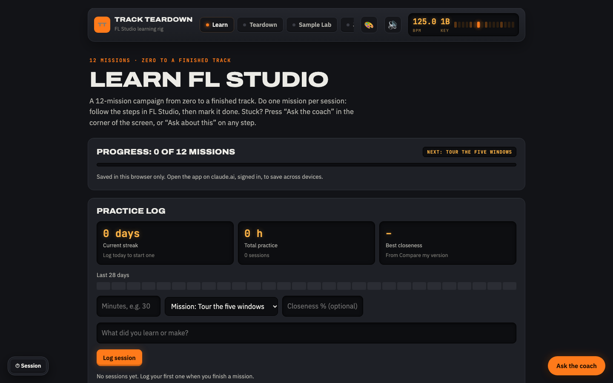 | 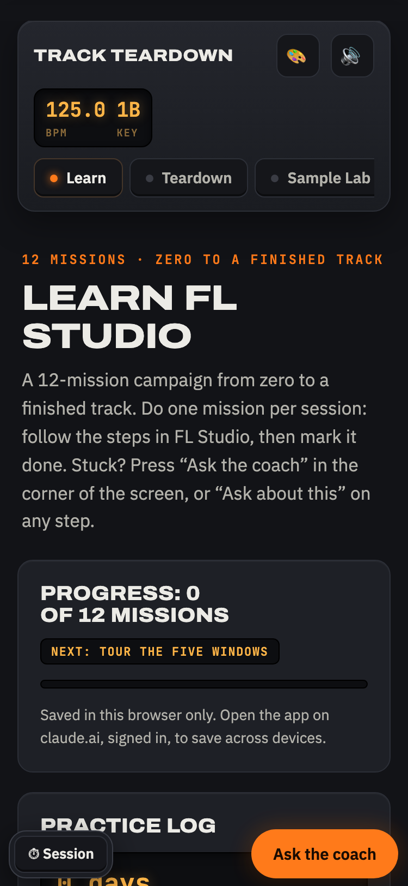 |
| Teardown, example |  |  |
| Overview | 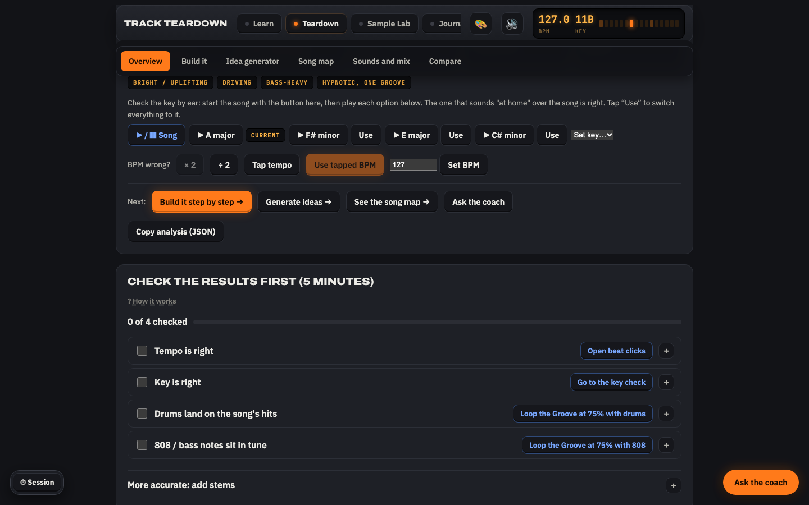 | 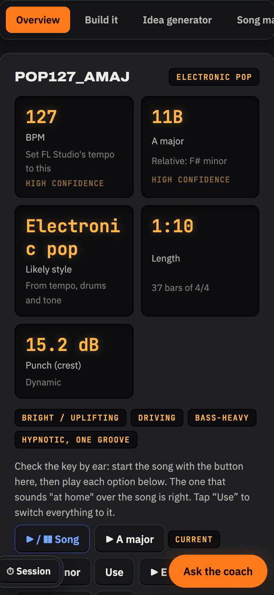 |
| Build it | 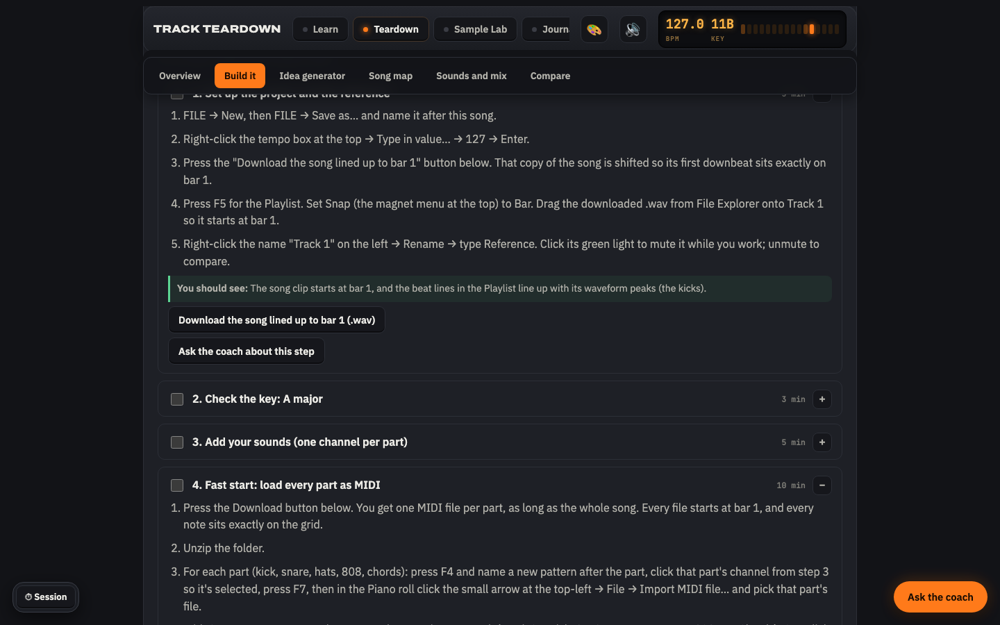 | 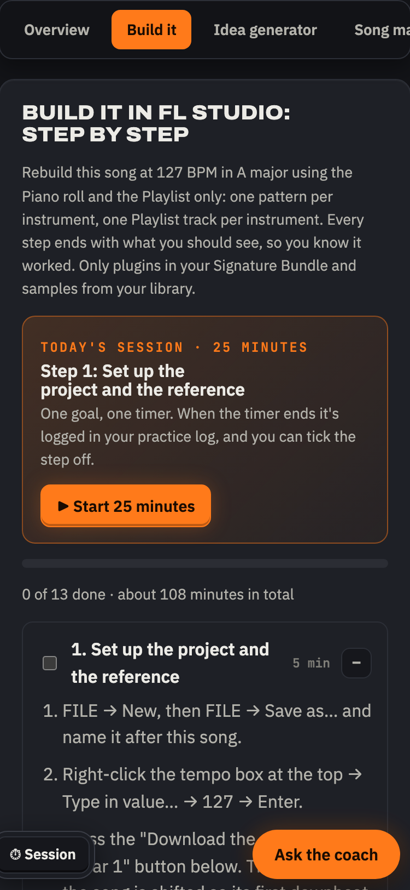 |
| Idea generator | 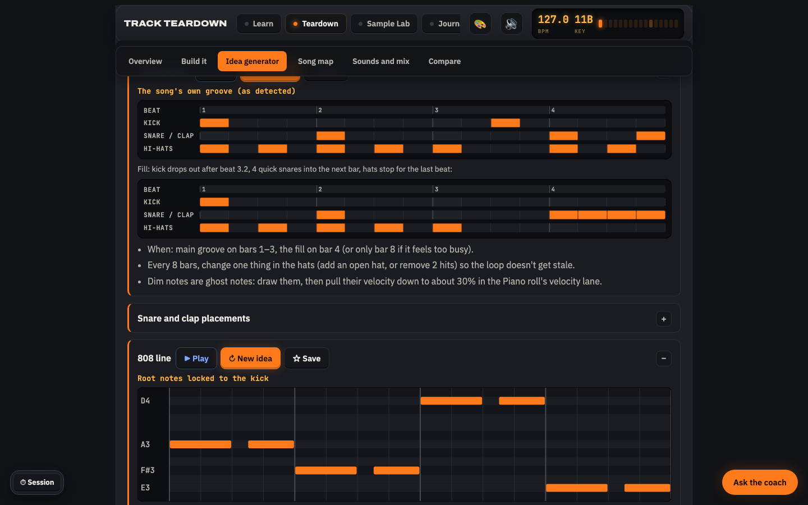 |  |
| Song map | 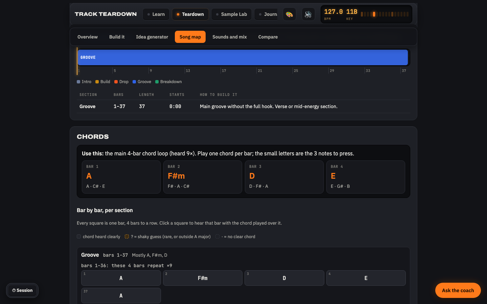 | 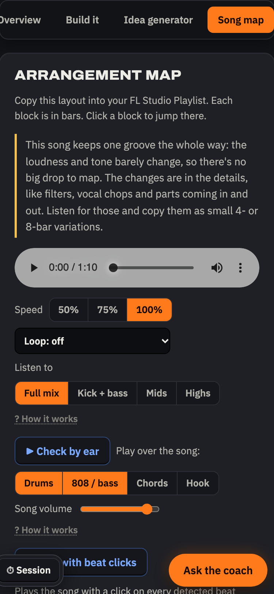 |
| Sounds and mix |  |  |
| Compare |  | 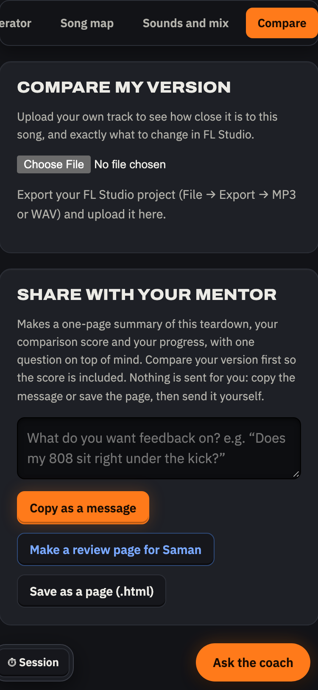 |
| Sample Lab | 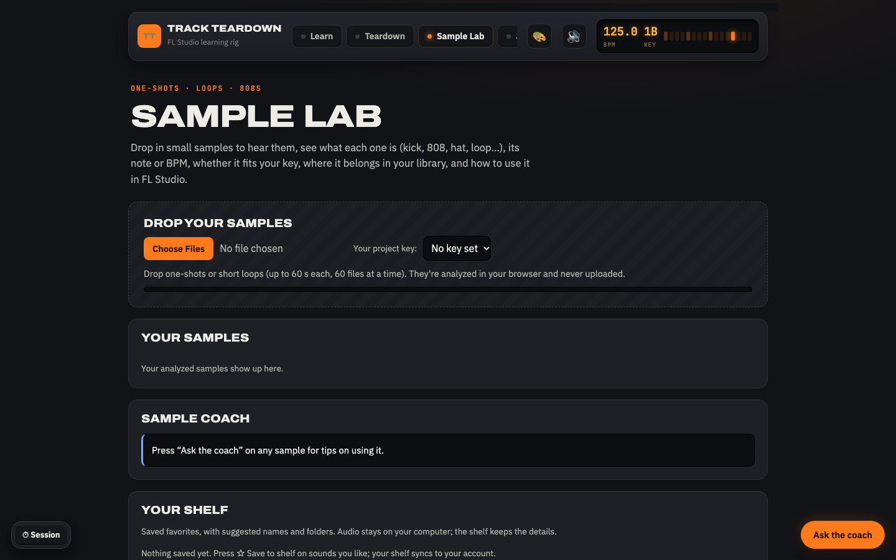 |  |
| Journal | 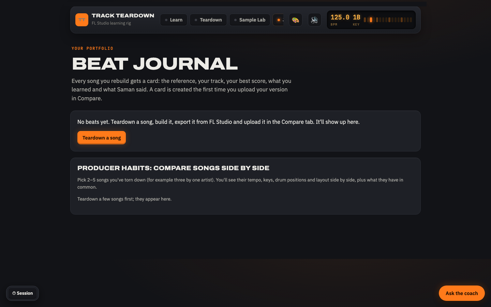 | 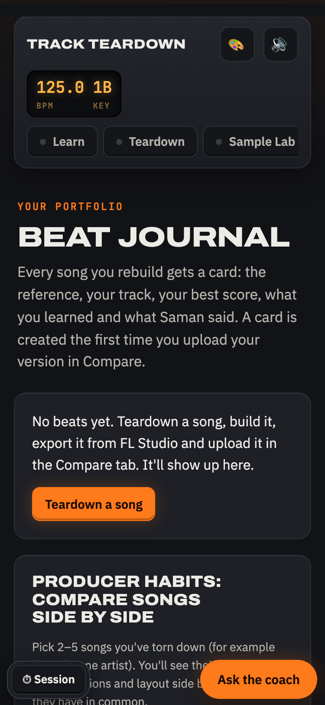 |

Existing layout defects visible in these screenshots (legacy; the new app does not reproduce them, per the founder's decision; legacy itself is unchanged): the "Journal" nav link is clipped at 1440 px desktop; on phone the style card breaks "Electronic" mid-word; on phone the fixed Session pill and "Ask the coach" button cover content at the bottom of the viewport.

---

## 11. Questions for the founder before M1 (answered 2026-11-18, see §0)

1. Approve the M1 scope? **Yes, amended** (multi-file build, Teardown default, external build hashes, test-build-only hooks).
2. Phase 2c continues in legacy? **Yes.**
3. Export confirmation UI? **Legacy first, with reusable domain-level validation.**
4. UI SDK beta? **Adopt, pinned, isolated.**
5. Single-file Claude artifact after cutover? **No; optional only.**

---

## 12. M1 record: scaffold, routing, tokens, UI SDK, TimeMap, build identity, target adapter, CI

**Scope delivered** (no feature code; the app cannot analyse, upload or save anything yet):

| Deliverable | Where | Notes |
|---|---|---|
| Isolated scaffold | `app/` (own `package.json`, `package-lock.json`, `.gitignore`) | Root install and the legacy CI job are unchanged. Exact pins: `svelte` 5.57.3, `vite` 8.3.8, `@sveltejs/vite-plugin-svelte` 7.3.1, `typescript` 6.0.3, `svelte-check` 4.7.8, `@types/node` 24.19.2, `@ui-sdk/svelte` + `@ui-sdk/core` 0.1.0-beta.6. npm 12 blocked the optional `fsevents` install script; nothing else needs one |
| Routing | `app/src/lib/routing/` | Hash router; **Teardown is the default** (empty and unknown hashes); Learn, Sample Lab, Journal are secondary; legacy hash names kept, so old links work; back/forward and reload work |
| Design tokens | `app/src/lib/design/tokens.css`, `base.css` | `--tt-*` tokens carried over from the legacy palette and type, plus space, radius, tap-size and motion tokens (`prefers-reduced-motion` honoured). TTdown owns the tokens; UI SDK parts are styled from them |
| UI SDK, isolated | `app/src/lib/ui/Popover.svelte`, `Tabs.svelte` | The only files importing `@ui-sdk/*` (plus `@ui-sdk/core/web.css` in `main.ts`), enforced by `app/scripts/check-ui-boundary.mjs` in `npm run app:check`. Props used are checked against the installed typings (Popover: `bind:open`; PopoverContent: `side`, `align`, `sideOffset`; Tabs: `bind:value`, `activation`; TabsPanel: `keepMounted`). Used in the shell: an "About this build" popover and the six teardown tabs (empty panels) |
| Canonical TimeMap | `app/src/lib/timemap/`, `vite.config.ts` plugin `ttdown-canonical-timemap` | `src/timemap.js` imported as-is (ES-module view generated at build time, no global). Verified in the **Vite dev server** and both **production builds**: the page's self-check fingerprint equals Node's (`tm1-8fcbbec555deff73` for a 120 BPM constant grid); one copy per bundle |
| Build identity | `window.__build` (`app/src/lib/build/identity.ts`); `app/dist/<build>/build-manifest.json` (`app/scripts/build-manifest.mjs`) | The bundle embeds only source facts: schema, app version, mode, test-hooks flag, git commit + dirty flag, TimeMap source sha256, Svelte/Vite/UI SDK versions. The manifest, written **after** the build, lists every compiled file's sha256 and a `bundleSha256` over them (sha256sum format). The target adapter refuses a page whose `__build` disagrees with its manifest |
| Test hooks | `app/src/lib/testing/hooks.ts` | Bench build only (`vite build --mode bench` → `app/dist/bench/`): `window.TimeMap`, `window.__ttdownTest`. The production bundle contains no hook code (checked). Nothing exposes audio buffers. The legacy hook contract (`__td`, `__sn`, `__analysisStats`, `__loop`, non-enumerable `grid`/`__buf`) arrives with the engine in M3 |
| Benchmark target adapter | `bench/lib/target.js`, `bench/run.js --target legacy\|svelte [--build bench]`, `tests/bench-target.test.js` (in `npm test`) | `legacy` (default) is the former inline code of `run.js`, moved unchanged, still `file://`; frozen Version A pages are labelled `frozen-version-a` by hash. `svelte` serves `app/dist/<build>/` over localhost through `scripts/dev-server.js` and verifies identity, but **refuses to analyse** (exit 2) until M3. `predictions.json` gains a `target` field |
| Localhost serving | `scripts/dev-server.js`, `tests/dev-server.test.js` | Allowlist + `app/dist/`, JS/CSS/JSON/woff2 types; security test 32 → 40 checks |
| Browser smoke test | `app/tests/smoke.mjs` (`npm run app:smoke`) | Against the dev server, the production build and the bench build, at 1440×900 and 375×812: default route, navigation by click/hash/back/forward/reload/unknown hash, TimeMap fingerprint = Node, `__build` vs manifest, hooks only in bench, no buffer globals, UI SDK popover (click, Escape) and tabs (click, arrow keys, panels kept mounted), no horizontal overflow, no clipped nav link, no page or console errors. 220 checks |
| CI | `.github/workflows/ci.yml`, new job `app` | `npm ci` + Playwright Chromium + `npm ci --prefix app`, then `app:check`, `app:build`, `app:smoke`; uploads build manifests and smoke screenshots. The legacy `test` job is untouched |

**Results** (this machine, worktree at `7ec5656` + the M1 changes, uncommitted at run time; Node 24.19, Chromium 159; each run once):

| Command | Exit | Wall | Result |
|---|---|---|---|
| `npm test` | 0 | 294 s | all unit suites pass incl. new `bench target tests passed (4)`; dev-server **40** checks; feature tests **15/15** |
| `npm run benchmark` | 0 | 24 s | **15/15 gates**, same values as §5 |
| `bench:synthetic` | 0 | 16 s | 8/8 tracks; per-track predictions **identical to the M0 run** (ignoring runtimes); only new key `target` |
| `bench:parity` / `bench:crosscheck` | 0 / 0 | < 1 s / 4 s | **104/104**, **120/120** |
| `bench:integrity` / `bench:regions` | 0 / 0 | 2 s / 1 s | pass |
| `bench:time-fixtures` | 0 | 25 s | 12/12; predictions **identical to M0** apart from runtimes and the `target` key |
| `app:check` | 0 | 3 s | `svelte-check` 0 errors, 0 warnings; `tsc` (config) clean; UI boundary ok |
| `app:build` | 0 | 2 s | production 302,142 bytes in 4 files (index.html, 1 CSS 89 KB, 2 JS 174 + 38 KB); bench 302,389 bytes |
| `app:smoke` | 0 | 9 s | **220/220** checks |

**Not done in M1, by design:** no analysis engine in the app and therefore **no analyzer parity claim**; `tests/benchmark.js` (G0) still loads the legacy page directly; `report.md` does not print `target` yet; fonts not self-hosted; no storage, audio, Claude runtime or export code; export confirmation UI (legacy, analysis workstream). The roadmap row (§0 note) is not edited here.

**Proposed M2** (needs the integration window, §7): extract the engine (index.html lines ~851–1366 at the time) to `src/engine/` as plain JS + `.d.ts`, inline it back into `index.html` between markers with `sync:engine` and a sync test, exactly like TimeMap; inject `probeDuration`; stats returned instead of written to a global; add `engineSha256` to `target`. Acceptance: legacy predictions identical on all 20 tracks, 15/15 gates, 104/104, 120/120. The Svelte app imports the engine in M2 only behind the typed facade, with no UI yet.

---

## 13. M2–M5 record: engine and domain extraction, the full Svelte app, parity, cutover

> **Superseded in part by §14.** This section records the feature-complete port as it was first built and verified. §14 cut most of those features (Learn, coach, journal, sample lab, build plan, idea generator, compare, share, display settings, session timer, accounts) and replaced the interface. The engine and domain extraction (M2 and the first half of M3), the parity method and the cutover configuration still stand; the feature lists, the app structure and the test lists below describe the earlier port.

Approved by the user on 2026-11-18 ("complete the full migration"), after PRs #19, #20 and #17 were merged into `main` (`169308c`, `dd3829a`, `1ffd25d`) and `main` was merged into this branch. The analysis workstream agreed an integration window: no engine changes in `index.html` until PR #18 merges; Phase 2c steps 3–5 then continue in `src/domain.js` and `src/engine.js`.

### M2: the analysis engine is one file shared by both apps

- `src/engine.js`: the engine block of `index.html` (DSP, `transcribe`, input limits, `probeDuration`, `analyze`), **moved verbatim**, inside a UMD factory `createEngine({ TimeMap })` that refuses to start without TimeMap (so a missing dependency can never silently drop the tracked section times). The one source change: the diagnostic counters are returned as `ANALYSIS_STATS` instead of being assigned to `window.__analysisStats` inside the engine.
- `index.html` inlines it between marker comments; `npm run sync:timemap` writes it and `npm test` fails on drift, as for TimeMap and TimingStore. The page destructures the names it uses from `TTEngine`.
- Defect found and fixed during M2: the page's Sample Lab awaits the engine's private `tick()`; the first M2 commit (`bc5b13a`) did not export it and test8 failed. Fixed in `058ae8f` (CI on `bc5b13a` failed for that reason).

### M3 (part 1): the domain logic is one file shared by both apps

`src/domain.js`: everything the page decides that is neither analysis nor drawing (teaching rules, genre guesses, the Build-it plan, the idea generators, `songNotes`, MIDI and zip writers, the aligned WAV, Compare scoring, sample analysis and naming, curriculum and shortcut data, share and review pages, the coach's data), 100 declarations, **verbatim and in their original order**, in a factory `createDomain({ TimingStore, engine })`, inlined into the page like the engine. Small behaviour-preserving splits so page state is passed in rather than read: `applyKey`/`applyTempo` (the page's `setKey`/`retempo` call them, then render and save), `makeIdeas` (the page's `ideasFor` keeps its cache), `coachData(a, ctx)`, `shareData(a, q, ctx)`, `keyFit(it, labKey)`. The idea generator's settings object `IDEAS` lives in the module.

Verification of M2 and the domain step on the legacy page: predictions identical to `main` (`1ffd25d`) on all 22 tracks (8 synthetic, 12 time fixtures, 2 arrangement fixtures), ignoring runtimes, including the tracked grid and the exported note times; `npm test` 17/17 feature tests; 15/15 gates; parity 104/104; crosscheck 120/120; integrity, regions, time fixtures, arrangement fixtures and arrangement-vs-Version-A pass.

### M3/M4: the Svelte application

Every view of the legacy page is a Svelte 5 component in `app/` (structure below), using the shared `src/` modules for all analysis and domain logic, so plans, ideas, notes and exported bytes cannot drift between the two apps.

```
app/src/
  App.svelte               shell: header (brand, views, Display, Volume, LCD), views, session pill, coach, About this build
  routes/                  Teardown (default), Learn, SampleLab, Journal
  teardown/                Summary, Accuracy (+ stems), MixMatch, BuildPlan, MidiPreview, SongExports, Lesson, Ideas, SongMap,
                           Chords (+ chord checker), Transcription, Drums, Layers, SamplesToGrab, ShelfMatch, Mix, Compare, Share
  components/              Display, Volume, Lcd, Session, Coach, EarTraining
  lib/engine, lib/domain   typed facades over src/engine.js and src/domain.js
  lib/persistence          TimingStore facade (docs/PERSISTENCE.md contract)
  lib/storage              same keys and shapes as the legacy page; Claude account documents (optional runtime)
  lib/state                teardown (job tokens, cancel, URL ownership, $state.raw + replacement), player, compare, session,
                           coach, sample lab, app
  lib/audio                one audio service (no AudioContext monkey-patch); idea player, Song-map tools, pattern player,
                           drone and ear-training sounds generated from the legacy source by script and only re-routed
  lib/ui                   TTdown components over UI SDK (Popover, Tabs), fold/help attachments, Rack, PianoRoll
  lib/design               tokens.css (TTdown tokens), components.css (carried-over component styles driven by the tokens),
                           app.css (shell layout and fixes for the legacy layout defects)
```

Decisions applied: results held in `$state.raw` and **replaced** on every correction (`teardown.replace()`, carrying the non-enumerable `grid`/`__buf`); the legacy page's render-time additions to a result (`checks`, `stems`, `chordChecks`) are reproduced so results and saved records are identical; test hooks only in the bench build (`__td` is assigned once per teardown shown, as the legacy `render()` did); fonts self-hosted (`@fontsource`, OFL-1.1, pinned 5.3.0); the legacy layout defects (§10) are fixed, not reproduced (navigation wraps, cards never wider than the screen, the teardown tab bar wraps on phones, the fixed controls never cover content).

### Parity evidence

| Gate | What it compares | Result |
|---|---|---|
| `npm run app:parity` (`bench/target-parity.js`, in CI) | `bench/run.js` on the legacy page (file://) and on the Svelte bench build (localhost), every track's full result, tracked grid and exported note times | **22/22 tracks identical** (8 synthetic, 12 time fixtures, 2 arrangement fixtures), same engine hash `1d4e805e…` on both sides, 0 page errors |
| `npm run app:feature-tests` (`tests/run-app-tests.js`, in CI) | the 17 legacy browser tests, unchanged except for a URL override and one selector (`[role=tab][aria-selected]` accepted next to `button[aria-pressed]`), run against the Svelte app | **17/17 pass** (286 s) |
| `tests/app-storage-roundtrip.test.js` (in CI) | legacy page and Svelte app on the **same origin**: each reads what the other saved (history with tracked timing, plan ticks, practice log), and the app writes no new keys | **pass** (8 checks) |
| `npm run app:smoke` | dev server, production and bench builds, desktop and phone: navigation, TimeMap, identity, hook gating, UI SDK by mouse and keyboard, nothing wider than the screen on any tab, no page errors | **376/376** |

Found and fixed by these gates: the Esc-to-cancel listener (legacy listens on `document`; the first port listened on `window`), and `window.__td` being a getter in the bench build (the legacy page assigns it, and test25/test26 observe the assignments). **No accuracy claim** follows from parity: the Svelte app reproduces the legacy analysis exactly, including its known defects (§8.3).

### Release-candidate review gates (2026-11-18)

An external review of the finished PR set these gates before production. Status:

| Gate | Status |
|---|---|
| Hosted CI green on the final head | Passed on `058ae8f` and `c1dbf97`; re-checked on the final head after the changes below (see the PR) |
| Netlify preview end to end | Checked on `5f97780`: `/` serves the Svelte production build (manifest commit `5f97780`, clean, 61 files, hashed assets `immutable`), `/legacy.html` serves the legacy page with the engine inlined |
| Saved-data round trip | Same-origin round trip both ways (above), plus `tests/app-saved-data-variants.test.js`: a real saved record with each optional field removed or nulled (28 variants) opens in the legacy page and the Svelte app alike. **Not possible here:** the founder's own browser data. localStorage is per origin, so only production (after merge) holds it; `/legacy.html` on that origin is the fallback if anything is odd |
| Audio playback and exports on desktop/mobile | Not verified on real devices here (headless Chromium only). Manual smoke test needed on Safari and a phone: play the song, Check by ear, beat clicks, the MIDI zip and the aligned WAV |
| Account integration in Claude | Exercised against a **mock** runtime only (`tests/app-account.test.js`); not against a real Claude runtime |
| Rollback rehearsal | Reverting the merge restores the legacy root; both apps use the same keys and shapes, so data written by either is read by the other (round-trip test) |

Two implementation risks raised by the review, verified and fixed:

1. **Late account connection.** It could never overwrite local state (migration only adds ids the account lacks, and nothing is written back into localStorage). But migration covered only history, log and progress, so plan ticks, saved ideas, journal cards and shelf items made while offline vanished from view once the account took over reads, and a refused write was never retried. Now migration covers every kind of saved data (still add-only), a refused write is remembered and retried at the next connection event, and the user is told when a write was refused. The legacy page has the same gaps; this makes the Svelte app a superset.
2. **Cached capability failures.** `useCap` kept a failed or absent capability for the page's lifetime. Now only a capability that was obtained is kept; a failure is retried on the next use.

`tests/app-account.test.js` (21 checks, mock runtime, data made by the real legacy page) covers both and fails on the previous code.

### Full suite on this branch (local, Apple M1, Node 24.19, Chromium 159)

| Command | Exit | Wall | Result |
|---|---|---|---|
| `npm test` (legacy page) | 0 | 298 s | 17/17 feature tests; unit suites incl. TimeMap, TimingStore, sync (timemap, timing-store, engine, domain), target adapter; dev-server 40 checks |
| `npm run benchmark` | 0 | 15 s | 15/15 gates |
| `bench:synthetic` / `bench:parity` / `bench:crosscheck` | 0 | 14 s / <1 s / 1 s | 8/8 scored; 104/104; 120/120 with mir_eval 0.8.2 |
| `bench:integrity` / `bench:regions` | 0 | 2 s / <1 s | pass |
| `bench:time-fixtures` / `bench:arrangement` / arrangement-vs-Version-A | 0 | 23 s / 6 s / <1 s | 12/12; 2/2; pass |
| `app:check` (svelte-check, tsc, UI boundary) | 0 | 3 s | 0 errors, 0 warnings |
| `app:smoke` / `app:parity` / `app:feature-tests` / storage round-trip | 0 | 14 s / 78 s / 286 s / 11 s | as in the table above |

Production build: about 1.5 MB in 61 files, most of it self-hosted font subsets; JavaScript and CSS are a small part.

### M5: cutover (prepared, not executed)

`netlify.toml` builds the app and publishes it at the root, with the legacy page at `/legacy.html` on the same origin and long-lived caching only for hashed assets. It changes PR #18's deploy preview immediately, so the founder can try the Svelte app there before deciding, and production only when PR #18 is merged. Rollback is reverting that merge (or only `netlify.toml`). Not done here, deliberately: merging PR #18 (production) and deleting the legacy page (kept for at least one release).

**Not migrated or known gaps:** the legacy page's `window.__rp` is a no-op in the app (the plan is reactive); the drag-and-drop and file inputs keep the legacy ids for the harness; `tests/benchmark.js` (G0 gates) still loads the legacy page, which runs the same engine file; the Claude runtime integrations (account sync, downloads, coach, dictation) are implemented as before but were not exercised against a real Claude runtime here.

---

## 14. v1 product focus (2026-11-18)

**Guiding question (founder):** when a producer uploads a track, what can Track Teardown tell them accurately that would otherwise take significant time and effort to discover? A feature that doesn't contribute to that outcome doesn't belong in v1. The space the cuts leave is **deliberately not refilled**: a smaller product with a few trustworthy findings beats a larger one with many questionable ones.

### What changed

| Area | v1 | Why |
|---|---|---|
| Positioning | "Upload a track and see how it is built." No DAW named anywhere in the app, README or test expectations; note names use standard pitch naming (middle C = C4, not FL's C5) | The product is analysis, not an FL Studio course |
| **Cut** | Learn, coach, journal, sample lab, session timer, build plan ("Build it"), idea generator, share/review pages, compare, display settings, the LCD and decorative console, navigation, accounts and every Claude-runtime integration (db, user, downloads, sample, dictation) | Not analysis. Compare is **deferred**: it needs credible comparison metrics first |
| Also cut | Generic mixing advice (EQ, effects, levels), plugin and sample recommendations, style and mood guesses, "high/medium/low confidence" labels, the "reference" tick on the energy bars, "how to build it" text per section, the band-solo listening filter, tap tempo, stems upload, the library matcher | Unsupported by evidence (confidences are not calibrated; style, mood and advice were never validated), or prescriptive |
| **Kept** | Tempo, key, meter assumption, bar 1, the arrangement, drum pattern, chords, rough bass and top line, measured level, dynamics, stereo width and band energy; playback with loops, speed, beat clicks and "check by ear"; corrections (tempo, key, a chord, a drum step); exports; saved teardowns; volume (now inside the player) | These are the findings and tools that answer the guiding question |
| Interface | One view. Upload, **What was found**, **Arrangement** (the timeline is the central object: click a section to select, hear and inspect it), **Export**, **How to read this** | The timeline replaces six tabs of disconnected statistics |
| Section detail | Tabs (UI SDK Tabs): **Rhythm**, **Harmony**, **Notes**. Notes appear only on the one section they were transcribed from, and say so | Stops presenting a one-section transcription as the whole song |
| Defaults | Dark theme, browser text size and zoom, `prefers-reduced-motion` honoured. No Display menu. A light theme following the system setting is not built (it would be new work) | Sensible defaults over settings |
| Example teardown | Removed. Until a track is analysed the page shows no numbers | Never show numbers that were not measured from the user's audio |

### Measured, estimated, assumed, unknown

Every finding carries exactly one label (`lib/ui/Basis.svelte`), explained on the page:

- **Measured**: computed directly from the audio (length, level, peak, crest factor, stereo width, band energy).
- **Estimated**: inferred by the analyzer (tempo, key, bar 1, sections and their names, drum pattern, chords, rough notes). Listen to it, check it, correct it.
- **Assumed**: not detected (4/4).
- **Unknown**: the analyzer found nothing and says so: no chords, no top line or bass, swing not measurable, no kick or snare in a section.
- **Corrected by you**: a correction; the page states that dependent results were not recomputed.

Uncalibrated numbers are not shown as probabilities. The tempo alternatives (half, double) come from TimeMap's hypotheses, which carry no score; the page words them as possibilities. The page says that accuracy has been checked only on computer-generated songs and not yet on real recordings.

### Corrections and exports

- Corrections replace the result (§0). **Phase 2d (docs/ROADMAP.md §9) then made them consistent:** with the audio, a tempo or bar-1 correction analyses the track again at that value (the result is a fresh analysis); without the audio it marks everything built on the bar grid out of date, hides it and blocks the bar-aligned exports. "This track isn't in 4/4" invalidates the same way. Every correction is recorded with its original value, and no confidence is invented.
- Exports use TimeMap's three-state eligibility (founder decision, 2026-11-18): **refused** (tempo changes or drift, non-4/4 meter) blocks the bar-aligned files with the reason; **needs confirmation** (always, until the user confirms: the analyzer's first downbeat and 4/4 are assumptions) shows two checks to make against the beat clicks, then unlocks them for the session; **allowed** after confirmation. Analysis data (.json, with the tracked beats) is always available. The confirmation is session-only; persisting it as a `timingCorrections` entry is part of the analysis workstream's export-confirmation work.

### Analytical components and benchmark infrastructure

Unchanged: `src/engine.js`, `src/timemap.js`, `src/timing-store.js`, and everything under `bench/`, the benchmark and parity gates, Version A and the legacy page as the harness's reference target. `src/domain.js` still contains the legacy page's teaching content (curriculum, idea generators, plan builder); the v1 app uses 17 of its names (`app/src/lib/domain/domain-module.d.ts`) and the rest is dead weight in the bundle until the legacy page is retired, at which point the analytical parts (`songNotes`, MIDI/zip/WAV writers, chord and key helpers) should move into a module of their own. The legacy page remains published at `/legacy.html` for one release, which is also the only place a person can still open the journal, practice log, favourites and shelf they saved there: those keys are left untouched in their browser, and the v1 app never deletes them (tested).

### Tests reflect the new product, not feature parity

`app:feature-tests` (the 17 legacy tests run against the app) is replaced by `app:product-tests` (`tests/run-app-tests.js`):

| Kept (legacy tests that still describe the product) | Ported to the new interface | New |
|---|---|---|
| test24 (TimeMap from the real grid), test25 (stale jobs), test26 (cancel), test27 (object URLs) | `app-limits` (was 28), `app-bars` (29), `app-sections` (30), `app-persistence` (31): same assertions, no tabs and no example teardown | `app-exports` (export gating and the first downbeat), `app-product` (26 checks: labels, timeline, volume in the player, no removed features, nothing leaves the browser, unknown shown as unknown) |

Not carried over, because the features are gone: tests 8, 14, 16, 17, 18, 19, 21, 22, 23 (Sample Lab, ideas, build plan, stems, journal and compare, volume menu, chord grid) and the account test. They still run, unchanged, against the legacy page in `npm test`. `app-storage-roundtrip` and `app-saved-data-variants` were rewritten for history only. The parity gate (`bench/target-parity.js`) ignores three fields the legacy panels add while rendering (`checks`, `stems`, `chordChecks`): interface bookkeeping, not analysis; every other field must still be identical.

### Size

Production build: 61 files and 1.55 MB before, 14 files and about 650 KB after (Latin font subsets only; the UI SDK default stylesheet is no longer shipped; the carried-over stylesheet was pruned from 30 KB to 12 KB by script). Dependencies are unchanged in kind and all used (`@ui-sdk/svelte` and its peer for Tabs, three self-hosted font packages, the toolchain).

### Results

Local, Apple M1, Node 24.19, Chromium 159, each command once:

| Command | Exit | Wall | Result |
|---|---|---|---|
| `app:check` (svelte-check, tsc, UI SDK boundary) | 0 | 15 s | 0 errors, 0 warnings |
| `app:smoke` | 0 | 23 s | 160 checks: dev server, production and bench builds, desktop and phone |
| `app:product-tests` | 0 | 226 s | 10 of 10 test files pass (including `app-exports`, 30 checks, and `app-product`, 26 checks) |
| `app:data-tests` | 0 | 131 s | round trip 9 checks; 28 saved-record variants open in the app wherever the legacy page opens them |
| `app:parity` | 0 | 109 s | 22/22 tracks identical to the legacy page (same engine hash), 0 page errors |
| `npm test` (legacy page, unchanged) | 0 | 340 s | 17/17 feature tests |
| `benchmark` / `bench:synthetic` | 0 | 18 s / 19 s | 15/15 gates; 8/8 scored |
| `bench:parity` / `bench:crosscheck` | 0 | 1 s / 1 s | 104/104; 120/120 with mir_eval 0.8.2 |
| `bench:integrity` / `bench:regions` | 0 | 3 s / 1 s | pass |
| `bench:time-fixtures` / `bench:arrangement` / arrangement-vs-Version-A | 0 | 41 s / 8 s / <1 s | 12/12; 2/2; pass |

`src/`, `index.html`, `bench/run.js`, `bench/score.js`, `scripts/` and the benchmark gates are byte-identical to the previous commit: this change touches the interface and its tests, not the analysis.

### Deliberately not done (the space stays empty)

No replacement for the cut features. Not built: a light theme, persisted export confirmation, compare, any new detection. (Bar-1 and meter correction were built afterwards, in Phase 2d.) Next priorities are analysis, not interface: correction-dependent results (Phase 2d: recompute or invalidate), a real-music benchmark, then making corrections genuinely useful. Open question for the founder: retire `/legacy.html` at cutover, or keep it for one release as the way to reach old journal and log data.
