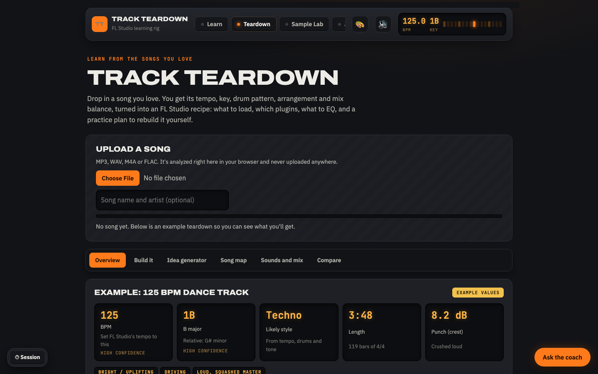
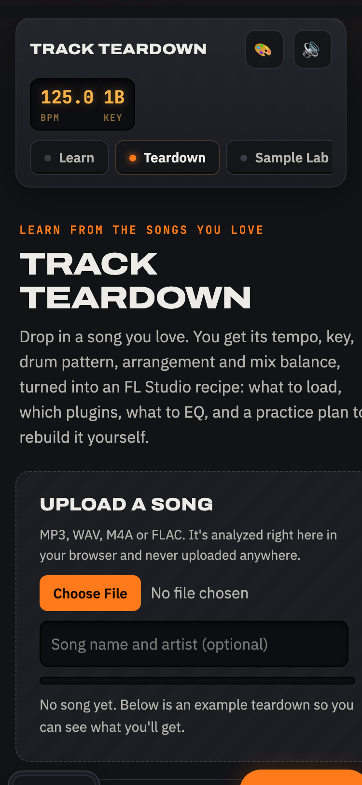
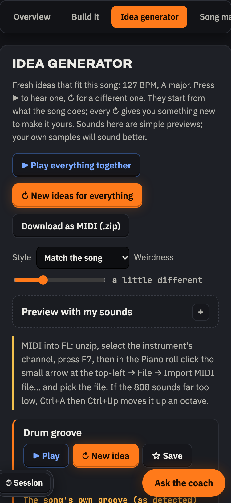
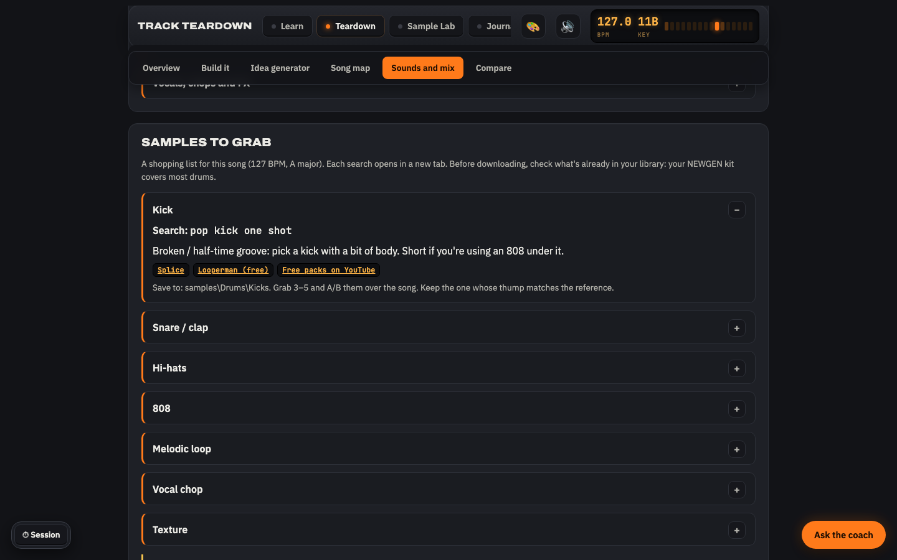
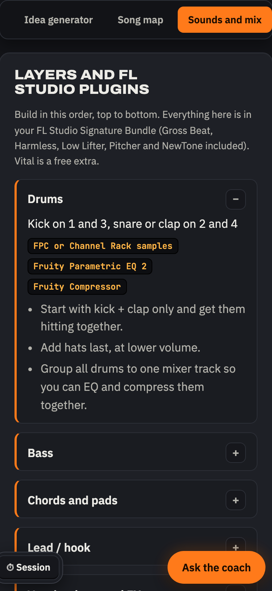
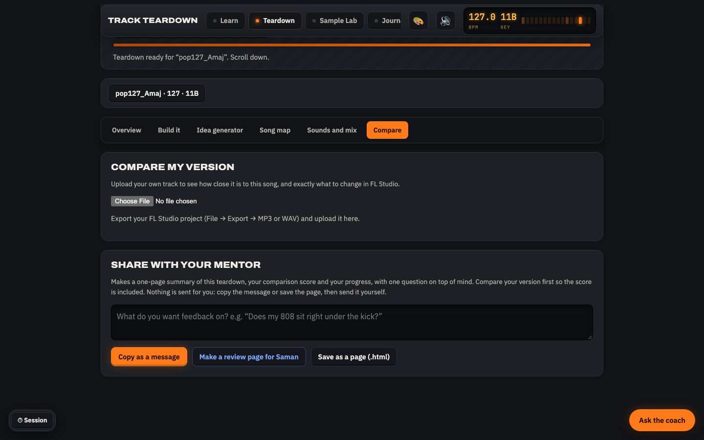
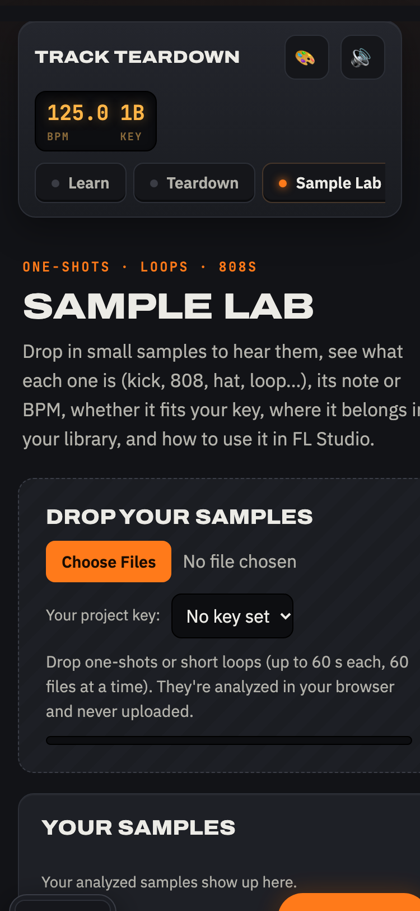

# Svelte 5 migration: Phase M0 (discovery and baseline)

Status: **M0 complete, waiting for founder review before M1.** This branch changes no application code: not `index.html`, not `src/timemap.js`, not the analysis, not Version A, not any benchmark or threshold. New files: this document, the legacy screenshots in `docs/migration/m0/` and the script that captures them.

| | |
|---|---|
| Migration source commit | `b2f05513b81787cfbc93632db98d1014fd2224ba` (`origin/main`, merge of PR #16, 2026-11-17) |
| `index.html` at that commit | 411,107 bytes, 3,702 lines, sha256 `416e8d4fee9700576d816ff818ce85c14de7fd96e85f42369dd11f6a6ec3a970` (differs from Version A's `a14fea96…` because of the reliability and Phase 2c step 1 PRs; the analysis output is unchanged, see §5` |
| Version A (never modified) | tag `analyzer-baseline-a` → `07b9012e5e1236137cb49d3d7bbc18554c06be6e` (`docs/BASELINE_A.md`) |
| Branch | `migration/svelte5`, worked in a separate git worktree so the main checkout (used by other sessions) was not switched |
| Roadmap note | `docs/ROADMAP.md` §5 lists "Framework migration (React/Svelte/Next/TypeScript)" as *rejected for this assignment*. The founder has now asked for a Svelte 5 migration; the roadmap row should be updated when M1 is approved (not done here, because roadmap PR #17 is open and edits the same file). |

**Rule for everything below.** A *migration regression* is a difference between the Svelte app and the legacy app on the same input. An *existing defect* is something the legacy app already does wrong (listed in §8 with its source). The migration must reproduce existing defects faithfully unless a separate, separately reviewed PR fixes them; it must not quietly fix or worsen them. No accuracy claim is made here beyond the synthetic benchmark evidence in §5, which is regression evidence, not real-music accuracy.

---

## 1. Sources read

`README.md`, `docs/ROADMAP.md` (and the open roadmap PR #17 diff), `docs/TECHNICAL_AUDIT_2026-11-16.md`, `docs/BASELINE_A.md`, `docs/TIMEMAP.md`, `docs/TIME_FIXTURES_BASELINE.md`, `bench/README.md`, `.github/workflows/ci.yml`, `scripts/dev-server.js`, `scripts/sync-timemap.js`, `bench/run.js`, `tests/run-tests.js`, every `tests/test*.js` header, and `index.html` (inventory by structured search of every storage key, runtime call, global, hash and heading, plus reading the shell, analysis entry, storage, history, routing, volume and display code; not every line of the ~2,300 lines of UI was read).

Open PRs (`gh pr list`, 2026-11-17): #17 roadmap (open), #4 G1-H harness (draft, superseded by #6), #3 Claude Code workspace (draft), #1 product strategy docs (draft). This PR is #18.

---

## 2. Application inventory (legacy `index.html` at the source commit)

### 2.1 Structure of the file

| Lines | Block | Notes |
|---|---|---|
| 1–326 | CSS | Design tokens as CSS variables (`--fs`, `--accent`, `--lcd`, `--hdr`, …); dark "console" look; `prefers-reduced-motion` honoured |
| 328–388 | Page shell | Header (brand, 4 nav links, Display, Volume, LCD readout), four `view-*` containers, upload card, history, `#out` |
| 389–825 | `<script>` 1: **TimeMap** | Inlined copy of `src/timemap.js` between `/* BEGIN src/timemap.js … */` and `/* END src/timemap.js */`. Exposes global `TimeMap`. Kept identical by `npm run sync:timemap`; `tests/timemap-sync.test.js` fails on drift |
| 826–3700 | `<script>` 2: everything else, one IIFE closure | See below |
| 829–850 | Volume | Wraps `window.AudioContext` / `webkitAudioContext` in a subclass that routes `destination` through a gain node (one volume for every sound the app makes) |
| 851–1366 | **Analysis engine** (DSP, `transcribe`, `analyze`) | Almost DOM-free: only `probeDuration()` creates an `<audio>` element; decoding uses `OfflineAudioContext`. Writes `window.__analysisStats`. Runs on the main thread with `await tick()` checkpoints (cancellable via `AbortSignal`) |
| 1367–1444 | Teaching rules | Genre guesses, plugin/sample advice |
| 1445–2128 | Rendering, Build-it plan, Idea generator, MIDI + zip writer | Hand-rolled `el()` DOM builder; `render(a, opts)` builds the teardown; `applyTabs()` groups sections into tabs **by matching `<h2>` text** |
| 2129–2248 | Whole-song notes, aligned WAV, Check by ear | `songNotes(a)` (exported MIDI timing), WAV padded/trimmed to bar 1, overlay synth |
| 2249–2379 | Progress, journal, habits, ear training, chord checker, review page | |
| 2380–2513 | Card folding, accuracy checklist + stems, player tools (speed, loop, solo band) | |
| 2514–2668 | Transcription view, samples that fit, compare band chart, library matches, share, session timer | |
| 2669–3104 | Samples to grab, key check, chord grid, retempo/setKey corrections, TimeMap grid adapter (`gridOf`), pattern playback, Compare, Coach | |
| 3105–3320 | Sample Lab | Per-sample analysis (`analyzeSample`), shelf |
| 3321–3575 | Learn FL Studio | Missions, shortcuts, FL coach, practice log |
| 3576–3699 | History, upload wiring (job tokens, cancel, object-URL ownership), example teardown, router, volume UI, sticky header, Display settings, boot | |

### 2.2 Top-level views (hash routes)

| Hash | View | Default | Contents |
|---|---|---|---|
| `#learn` (also empty or unknown hash) | Learn | **yes**: `route()` falls back to `learn` | FL Studio missions and progress, keyboard shortcuts, "Ask your FL Studio coach", practice log, ear training (appended by a wrapper around `renderLearn`) |
| `#teardown` | Teardown | | Upload, history, the six teardown tabs |
| `#samples` | Sample Lab | | Drop samples, per-sample analysis, filter, sample coach, shelf |
| `#journal` | Journal | | Beat journal cards per teardown, exports, notes |

`hashchange` drives both `route()` and the coach's context refresh. `location.hash = "learn"` is set programmatically from Compare ("Log this score in my practice log"). No `pushState`/`replaceState`; no query parameters.

### 2.3 Teardown tabs (`TD_TABS`, line 1451)

Tabs are buttons in `nav.tdtabs` (`aria-pressed`), not routes; the active tab is in the `tdTab` variable, reset to Overview on every new analysis. A section is assigned to a tab by `data-group` or, failing that, **by a regex on its `<h2>` text** (`applyTabs`).

| Tab (`key`) | Sections (heading as rendered) | Interactive features |
|---|---|---|
| Overview (`overview`) | "2. …" summary stats; key check by ear; "Check the results first (5 minutes)" accuracy checklist with stem uploads; "Your practice plan"; "Share with your mentor" | Play-the-key drone, set key by ear (`setKey`), BPM correction (`retempo`), stem upload rows, review page and share page downloads |
| Build it (`build`) | "3. Build it in FL Studio: step by step" | 13-step plan, per-step MIDI picture and download, step ticks (`td_plan_v1` / account `plan-*`), warnings on shaky detections, 25-minute session timer start |
| Idea generator (`ideas`) | "4. Idea generator" | Drum/808/chord/melody/vocal-chop/arrangement ideas in key and tempo, selects and sliders, playback, favourites (`idea_favs_v1` / account `idea-*`), MIDI and zip export |
| Song map (`map`) | "5. Arrangement map", "6. Chords", "7. Drum pattern", "8. Frequency balance", "What the song plays (rough transcription)" | Player with bar ruler (TimeMap), metronome, loop 4 bars, speed, solo a band, Check by ear overlay, chord grid click-to-hear, chord checker, editable 16-step drum pattern (`patternEdited`) |
| Sounds and mix (`sound`) | "9. Layers and FL Studio plugins", "10. Samples to grab", "11. EQ and mix moves", "Your samples that fit this song", "Mixes with this (from your library)" | Links into Sample Lab shelf |
| Compare (`compare`) | "12. Compare my version", "Producer habits: compare songs side by side" | Upload your version (analysed with `analyze(…, opts_compare = true)`), closeness score, fixes list, band chart, drum racks, log the score |

Global chrome: header LCD (BPM, Camelot key, LEDs), Display menu, Volume menu, practice-session pill (`.sess`), floating Coach panel, compact header on scroll, `#save-note` storage status.

### 2.4 Analysis result object (`a`)

Enumerable fields (what history, account sync, share pages and the coach see): `title, duration, bpm, bpmConf, key, camelot, keyConf, relKey, keys (top 4), pattern {kick, snare, hats, ghost?}, rhythm, sections[{label,start,end,startBar,bars}], barSec, nBars, firstDown, chords, balance, width, loudRms, crest, peakDb, bassNote, hook/bass transcriptions`, and user-correction flags `keyFixed, patternEdited`.

**Non-enumerable (must be preserved exactly):**

| Property | Defined at | Value | Why non-enumerable |
|---|---|---|---|
| `grid` | line 1360 | `{ source: "dp-tracker" \| "dp-tracker (too few beats; downbeats not chosen)", beats: number[], downbeats: number[] }` (seconds, 4 dp) | So saved history, sync, share and coach payloads are byte-identical to before the grid existed. Consequence: **a saved teardown has no `grid`**, and TimeMap falls back to a labelled constant grid |
| `__buf` | line 1363 | the decoded `AudioBuffer` (not set for compare analyses) | Lets `handle()` adopt the buffer only if the job is still current |

### 2.5 Persisted data

**localStorage** (all JSON; every read/write wrapped in try/catch via `lsGet`/`lsSet`, except volume which has its own try):

| Constant | Key | Shape | Limit / notes |
|---|---|---|---|
| `VK` | `app_volume_v1` | `{ song, sounds, muted }` | |
| `DK` | `display_v1` | `{ size: s\|m\|l, density: comfy\|compact, accent: hex, sticky: bool }` | |
| `HK` | `teardown_history_v1` | array of result objects (enumerable fields only) | 12 entries, de-duplicated by title + duration (finding C1-9) |
| `PLK` | `td_plan_v1` | `{ "plan-<tdId>": [stepIds] }` | |
| `FK` | `idea_favs_v1` | idea favourites | |
| `JK` | `beat_journal_v1` | journal entries `{ id: "jr-<tdId>", title, ref, exports[≤30], learned, … }` | |
| `EK` | `ear_training_v1` | ear-training stats | |
| `SESK` | `td_session_v1` | running session `{ start, mins, goal, ref }` or `null` | |
| `SHK` | `sample_shelf_v1` | sample shelf | |
| `PK` | `fl_campaign_v1` | mission progress map | |
| `LK` | `fl_log_v1` | practice log entries | 300 entries |

`tdId(a)` = `"td-" + slug(title)[0..40] + "-" + round(duration)`; it keys history, plans and journal entries.

**Claude account storage** (when running as a Claude artifact): `window.claude.use("db")` + `window.claude.use("user")` → collection `data/users/<uid>`, live `onSnapshot`. Document types and ids:

| `type` | Document id | Written by |
|---|---|---|
| `teardown` | `tdId(a)` | `saveHist`, `migrateLocal` |
| `plan` | `plan-<tdId>` | `setPlanDone` |
| `progress` | `progress` | `setProg`, `migrateLocal` |
| `session` | `s-<timestamp>` | `addLog` |
| `idea` | `idea-<timestamp>` | `favAdd` |
| `journal` | `jr-<tdId>` | `journalPut` |
| `sample` | `shelfId(item)` | shelf save |

States `connecting → account | local` (10 s timeout). `migrateLocal()` copies local progress, history and log into the account once. With an account, history shows up to 24 teardowns. Quota errors show "Your saved space is full…".

### 2.6 Claude-artifact runtime integrations (`window.claude.use`)

All are feature-detected; the app works without them.

| Capability | Lines | Use | Fallback |
|---|---|---|---|
| `db`, `user` | 3419 | Account storage (above) | localStorage |
| `downloads` | 2003, 2138, 2188, 2199, 2628, 2631 | `dl.save({ filename, data })` for MIDI zip, single MIDI, aligned WAV, idea zip, review page, share page | `<a download>` with an object URL revoked after 4 s |
| `sample` | 3016 (`getSample`), used at 3082, 3259, 3511 | LLM coach: `sample(prompt, { signal, onText })` streaming; teardown coach, sample coach, FL coach | "The coach isn't available in this view" |
| `dictation` | 3095 | Mic button in the coach: `start/stop/onPartial/onFinal` | mic hidden |

Privacy note (from the audit, unchanged): analysis JSON including the song title is synced and sent to the coach as prompt context; audio is never uploaded.

### 2.7 Exports

| Export | Function | Timing source today |
|---|---|---|
| Full-song MIDI per part (kick, snare, hats, 808, chords, hook), zip | `songNotes`, `midiBytes`, `zipStore` | constant `firstDown + n·barSec` grid (TimeMap step 6.5 not yet done) |
| Single-part MIDI from Build it | `midiBytes` | same |
| Reference WAV lined up to bar 1 | line 2166 | constant grid |
| Idea generator MIDI / zip | `midiBytes` | generated, tempo only |
| Review page / share page (`.html`) | `reviewHtml`, `shareData` | n/a |

### 2.8 Diagnostic and test hooks (a contract the tests and the benchmark depend on)

| Hook | Defined | Used by |
|---|---|---|
| `window.__td` | `render()` line 1482: the result on screen | `bench/run.js`, `tests/benchmark.js`, tests 17, 18, 21, 24–29 |
| `window.__sn(a)` | line 2164: `songNotes(a)` (exported note times, `stepSec`) | `bench/run.js`, `tests/benchmark.js`, test17 |
| `window.__rp(a)` | line 1753: `refreshPlan(a)` | (present; no current caller found in tests) |
| `window.__analysisStats` | line 980: `{ checkpoints, aborted }` | test26 |
| `window.__loop` | line 2487: non-enumerable getter for the active loop range | test29 |
| `window.TimeMap` | inlined script | test24, test29 |
| `result.grid`, `result.__buf` | non-enumerable (§2.4) | `bench/run.js`, `bench/score.js`, `bench/timing-consumers.js`, `bench/time-fixtures-summary.js`, tests 24, 25, 28, 29, `tests/benchmark.js` |
| `#file`, `#status` (text matching `/ready|Couldn/`), `#cancel`, `#hist button` | page shell | `bench/run.js` and almost every browser test |

The browser tests also select on ~60 other selectors and visible texts (`.tdtabs button:has-text(…)`, `section:has(h2:has-text(…))`, `#plan .pstep`, `#ideas select.isel`, `.ptools`, `.chcheck`, `.sess .stime`, `#vol-song`, `.barruler`, …). **The browser tests are coupled to the legacy DOM and copy, not to behaviour.** Only `bench/run.js` uses a small contract (`#file`, `#status`, `__td`, `__sn`, `grid`).

**All browser tests and the benchmark harness load the page from `file://`** (`bench/run.js` line 62; tests via `ROOTURL = 'file://…'`). A Vite build that emits `<script type="module" src=…>` will not run from `file://` in Chromium (module scripts are fetched with CORS). This shapes the benchmark plan in §6.

### 2.9 Corrections (user edits)

| Edit | Function | Behaviour (existing, see §8) |
|---|---|---|
| Key set by ear | `setKey` | overwrites `key`, sets `keyConf = 99`, `keyFixed = true` |
| BPM | `retempo` | overwrites `bpm`, sets `bpmConf = 99`, rescales `barSec`, `nBars`, section bars only; chords, drum grid, first downbeat not recomputed; TimeMap drops the tracked grid for a labelled fallback |
| Drum steps | pattern editor | `patternEdited = true` |

Corrections mutate the result in place and are saved via `saveHist`.

---

## 3. In-flight work that touches the same code

| Work | Where | Impact on the migration |
|---|---|---|
| **Phase 2c consumer migration onto TimeMap**: step 1 (ruler, metronome, loop) merged in #16; **step 2 (sections and arrangement) in progress in another session right now** (no branch pushed at the time of writing); then chords + chord-check loops, drum/bass event timing + overlay, MIDI + aligned-audio exports behind the three-state gate | `index.html` (`render`, `gridOf`, `songNotes`, overlay), `src/timemap.js`, `tests/timing-consumers.test.js`, `bench/baselines/version-a/consumers/` | **The largest conflict risk.** Every Phase 2c step changes exactly the timeline code the Svelte app must reproduce. The legacy app keeps moving during M1–M3, so the parity target is a moving commit (see §7) |
| Phase 2d corrections (recompute/invalidate, no hard-coded 99) | `setKey`, `retempo`, TimeMap fingerprint | Not started. Must land in one place only; see §7 |
| Export confirmation UI (metronome audition, first-downbeat check, meter confirm) | not built | Founder decision 2026-11-18 (roadmap PR #17 §8). Building it in legacy *and* in Svelte would double the work: decide where (§11 question 3) |
| Roadmap PR #17 | `docs/ROADMAP.md` | Edits the same file the migration's roadmap row lives in; not touched here |
| Real-music pilot (Phase 1) | `bench/` | Blocked on rights and annotators. Uses `bench/run.js` → must keep working against the frozen and legacy pages (§6) |
| Draft PRs #1, #3, #4 | docs, agent workspace, superseded harness | No code overlap |

`src/timemap.js` is a classic script (no ES module) so it can be `require`d by Node tests and inlined into the page. The Svelte app must consume **the same file**, not a copy (§4.3).

---

## 4. Proposed architecture

### 4.1 Layout

```
app/                        Svelte 5 + Vite + TypeScript (new; nothing outside app/ moves in M1)
  index.html                Vite entry
  vite.config.ts
  tsconfig.json
  src/
    main.ts                 mounts App, imports @ui-sdk/core/web.css
    App.svelte              shell: header, nav, Display, Volume, LCD, routes
    routes/                 Learn, Teardown, SampleLab, Journal (hash router)
    teardown/               Overview, BuildIt, IdeaGenerator, SongMap, SoundsMix, Compare
    lib/
      engine/               typed facade over the analysis engine (no Svelte, no DOM beyond Web Audio)
      timemap.ts            typed re-export of ../../src/timemap.js (single canonical copy)
      storage/              localStorage + Claude account adapters, same keys and doc ids
      runtime/claude.ts     typed wrappers for window.claude.use(db|user|downloads|sample|dictation)
      export/               MIDI, zip, aligned WAV, share/review pages (pure functions)
      audio/                volume routing, players, metronome, overlay synth
      state/*.svelte.ts     runes-based stores ($state, $derived) for current teardown, history, settings
      testing/hooks.ts      installs window.__td, __sn, __analysisStats, __loop (always on; same contract as legacy)
src/timemap.js              unchanged, still the single source of truth
src/engine/                 (M2) analysis engine extracted from index.html, framework-independent, plain JS + .d.ts
index.html                  legacy app, untouched until cutover
```

### 4.2 Framework-independent engine

- The engine (lines 851–1366 today) moves to `src/engine/` in M2 as **plain JavaScript with hand-written `.d.ts` types**, not TypeScript source: the legacy `index.html` must keep inlining it byte-for-byte (same mechanism as TimeMap: marker comments + a sync script + a sync test), so both apps run identical analysis code and `bench:parity` stays meaningful. Converting the engine to TypeScript is out of scope until the legacy page is retired.
- Engine dependencies to cut: `probeDuration` (uses `<audio>`; inject it), `window.__analysisStats` (return stats or accept a sink; the app re-exposes the global), `tick()` checkpoints (unchanged).
- Moving the engine into a Web Worker is **not** part of the migration (roadmap Phase 9). It would change timing and cancellation behaviour, which would confound parity.

### 4.3 Single canonical TimeMap

`src/timemap.js` stays the only implementation. The Svelte app imports it through a tiny typed wrapper (`app/src/lib/timemap.ts` + `timemap.d.ts`); Vite handles the CommonJS/global shape. No TypeScript port, no second copy. The legacy page keeps its inlined copy via `sync:timemap`. A test asserts the Svelte bundle contains no other TimeMap implementation.

### 4.4 Typed engine contract

```ts
// app/src/lib/engine/types.ts (sketch; field list completed from the real result in M2)
export interface TrackedGrid { source: "dp-tracker" | "dp-tracker (too few beats; downbeats not chosen)"; beats: number[]; downbeats: number[] }
export interface AnalysisResult { title: string; duration: number; bpm: number; bpmConf: number; key: string; camelot: string; keyConf: number; relKey: string;
  barSec: number; nBars: number; firstDown: number; sections: Section[]; pattern: DrumPattern; /* … */ keyFixed?: boolean; patternEdited?: boolean }
export interface AnalysisRun { result: AnalysisResult; grid: TrackedGrid | null; buffer: AudioBuffer | null }
export function analyze(file: File, onProgress: (pct: number, msg: string) => void, opts: { compare?: boolean; signal?: AbortSignal }): Promise<AnalysisResult>;
export function gridOf(r: AnalysisResult): TrackedGrid | undefined;    // reads the non-enumerable property
export function bufferOf(r: AnalysisResult): AudioBuffer | undefined;
```

Rules: the engine keeps attaching `grid` and `__buf` with `Object.defineProperty(…, { enumerable: false, configurable: true })`; the TypeScript type **does not** declare them as fields (so `JSON.stringify`, spreading and Svelte `$state` proxies cannot be written to depend on them); access goes only through `gridOf`/`bufferOf`. Results are held with `$state.raw` (not deep `$state`), because a deep proxy would not carry non-enumerable properties through copies and would make `__buf` reactive. A unit test checks that a stored, re-loaded and proxied result keeps the legacy JSON byte-for-byte and that `gridOf` survives where it must.

### 4.5 UI SDK (verified, not assumed)

Verified on 2026-11-17 from https://ui-sdk.dev/docs/svelte, `/docs/svelte/installation`, `/docs/svelte/components` and the published tarballs (`npm pack`, not installed):

| Fact | Value |
|---|---|
| Packages | `@ui-sdk/svelte` and peer `@ui-sdk/core` |
| Version | `latest` = `0.1.0-beta.6` (dist-tag `beta` is `0.1.0-beta.8` / core `0.1.0-beta.9`). **Beta**: "some APIs may still change" |
| Peer dependencies (`@ui-sdk/svelte`) | `svelte >=5.33`, `@ui-sdk/core ^0.1.0-beta.6` |
| Licence | Apache-2.0 (package.json); source `github.com/vercel-labs/ui` |
| Install | `npm install @ui-sdk/svelte @ui-sdk/core`; Vite: `import "@ui-sdk/core/web.css"` in `main.ts` |
| Provider | none required |
| Imports | one subpath per component, e.g. `import { Tabs, TabsList, TabsTab, TabsPanel } from "@ui-sdk/svelte/tabs"` (export map has 60+ subpaths incl. `button`, `dialog`, `popover`, `slider`, `select`, `toast`, `tabs`, `switch`, `segmented-control`, `progress`, `file-input`, `tooltip`) |
| Styling | unstyled; `data-slot` / state attributes and per-component CSS variables; optional default `web.css`. No documented theme or dark-mode tokens, so the existing CSS variables (`--accent`, `--fs`, …) remain the theme |
| Tabs API (checked in `tabs.svelte.d.ts`) | `Tabs`: `value?: string \| null` (`bind:value`), `defaultValue`, `onValueChange(value, details)`, `orientation`, `activation: "automatic" \| "manual"`, `loop`, `hiddenUntilFound`; `TabsTab`: `value`, `disabled`; `TabsPanel`: `value`, `keepMounted`, `hiddenUntilFound` |
| Slider | `value` (`bind:value`), `min`, `max`, `step`, `onValueChange`, `onValueCommit`, `orientation`, `disabled`; parts `SliderControl`, `SliderTrack`, `SliderIndicator`, `SliderThumb`, `SliderValue` |
| Popover | `PopoverTrigger`, `PopoverContent` (`side`, `align`, `sideOffset`, …), `bind:open`, `onOpenChange`, `modal` (default `false`) |
| Not documented | browser support, SSR is irrelevant here (client-only Vite app) |

Planned mapping (only documented props; each confirmed against the installed `.d.ts` in M1/M4): Display and Volume menus → `Popover`; volume and idea sliders → `Slider`; teardown tabs → `Tabs` with `keepMounted` (the legacy page keeps hidden sections in the DOM, and players must not be destroyed on tab switch); upload → `FileInput` or a native input (the harness needs `#file`); status messages → `Toast` only where the legacy page shows a transient note, never for `#status`; dialogs → `Dialog`/`AlertDialog`. Pin the exact beta version (no caret) and upgrade deliberately.

### 4.6 Toolchain (versions checked on npm 2026-11-17)

`svelte` 5.57.3 (≥ 5.33 required by UI SDK), `vite` 8.3.8 (Node ^20.19 or ≥ 22.12; CI uses Node 22, this machine 24.19), `@sveltejs/vite-plugin-svelte` 7.3.1 (peer `vite ^8`, `svelte ^5.46.4`), `svelte-check` 4.7.8. **`typescript` must be pinned to 6.x (6.0.3)**: `latest` is 7.0.2 but `svelte-check` declares `typescript ^5.0.0 || ^6.0.0`. Plain Vite + Svelte (not SvelteKit): the app is a static single page with hash routes and no server.

**Single-file output.** The legacy app also runs as a single-file Claude artifact and from `file://`. The Svelte build should therefore offer a single-file output (`vite-plugin-singlefile` 2.3.4, MIT, peer `vite ^8`) that inlines JS and CSS into one HTML. Inline module scripts run from `file://`, which would let the existing `file://`-based harness load the Svelte build unchanged. To be proven in M1 (it is the main technical unknown).

---

## 5. Recorded baseline (this machine, source commit, before any migration work)

Environment: Apple M1, macOS 27.2 (Darwin 27.2.0), Node v24.19.0, npm 12.0.2, Playwright 1.65.1 (Chromium headless shell 159), Python 3.12.0; crosscheck in a venv with numpy 2.5.5 and mir_eval 0.8.2. Songs generated with `python3 test-songs/make_test_songs.py` (4.8 s) and `python3 test-songs/make_time_fixtures.py` (12.4 s) (`python` on this machine has no numpy). **Provenance.** The recorded run below was made in a dedicated, clean, detached worktree at `b2f0551` (`git worktree add --detach <dir> b2f0551`): every output records `headSha b2f0551`, `gitDirty: false`, page sha256 `416e8d4f…` (benchmark record `tests/out/benchmark-2026-11-18T03-33-27-587Z.json`). Each command run once, sequentially; wall time measured around `npm run`. An earlier run in this branch's own worktree (HEAD `57d8584` = `b2f0551` + this doc only, so `gitDirty: true`; identical page sha256) gave the same exit codes, and its `bench:synthetic` and `bench:time-fixtures` predictions are **identical** to the clean run's apart from runtimes. Neither run used the shared checkout `/Users/keina/dev/ttdown`, which another session had switched to `phase2c/sections-arrangement` during that time.

| Command | Exit | Wall time | Peak RSS (driver) | Result |
|---|---|---|---|---|
| `npm test` | 0 | **315 s** | 516 MB | metrics, TimeMap (35 cases), TimeMap sync, timing consumers, bench metrics, integrity/coverage, holdout, regions tests passed; dev-server 32 checks passed; **feature tests 15 passed, 0 failed** (test8, 14, 16–19, 21–29) |
| `npm run benchmark` | 0 | **19 s** | 276 MB | **15/15 gates passed**. Kick P0.94 R0.98, snare P1.00 R0.98, hats P1.00 R0.93, chords 213/213, key exact 4/6 (same notes 6/6), hook P0.94 R1.00; tempo Acc1/Acc2 1.000/1.000; tracked beat F 0.994, downbeat F 0.978; exported grid beat F 0.995, downbeat F 0.986; ~1.4–1.6 s per song. Record `tests/out/benchmark-2026-11-18T03-33-27-587Z.json` (not committed) |
| `npm run bench:synthetic` | 0 | **20 s** | 277 MB | **8/8 tracks scored**, 0 problems. Tempo Acc1 1.000; beats F 0.9936 [0.9921, 0.9953]; downbeats F 0.9776; exported beats/downbeats F 0.995 / 0.9864; key exact 0.75, weighted 0.825; chords root = majmin 0.9948; kick/snare/hat F ±50 ms 0.9453 / 0.9875 / 0.9463; hat ±30 ms 0.8838; bass onset F 0.8575, note F 0.8293, octave errors 0 |
| `npm run bench:parity` | 0 | < 1 s | 73 MB | **104/104** checks match G0 |
| `npm run bench:crosscheck` (venv) | 0 | 2 s | 100 MB | **120/120** values agree with mir_eval 0.8.2 within 0.001 |
| `npm run bench:integrity` | 0 | 2 s | 74 MB | score integrity tests passed |
| `npm run bench:regions` | 0 | 2 s | 73 MB | regions scoring tests passed |
| `npm run bench:time-fixtures` | 0 | **34 s** | 415 MB | 12/12 fixtures; per-fixture table **identical** to `docs/TIME_FIXTURES_BASELINE.md` (e.g. `dnb_174` 174 → 87 half, `drift_fast` exported beat F 0.31 and refused: tempo-changes, `meter_3_4` downbeat F 0.29, `long_7min` 1.00) |

All values match the Version A record in `docs/BASELINE_A.md` and the roadmap: the reliability PRs and Phase 2c step 1 changed no analysis output. The feature-test count rose from 9 to 15 since Phase 0 (tests 24–29 added). Total wall time for the suite: about 6.6 minutes (7.6 in the first run), dominated by the browser feature tests; one run each, so timings are indicative only.

These are regression numbers on synthetic songs only. **Real-music performance: not measured.**

---

## 6. Benchmark compatibility plan

Goal: the same harness, the same manifests and the same scorer measure three builds, and every output says which build it measured.

| Target | How it is loaded | Purpose |
|---|---|---|
| **Frozen legacy** (Version A) | `git show analyzer-baseline-a:index.html > versionA.bak.html`, `file://` (as today) | Reference; never changes |
| **Current legacy app** | repo `index.html`, `file://` (as today) | Moves with Phase 2c; the parity target |
| **Svelte app** | `npm run build` in `app/` → `app/dist/`; single-file build over `file://`, or the multi-file build over `http://localhost` from an allowlisted static server | Candidate |

1. **Test adapter, not test rewrites.** A small module (`bench/lib/target.js`) gives `run.js` and `tests/benchmark.js` one interface: `open(page)`, `upload(path)`, `waitDone()`, `readResult() → { full, grid, exported }`, `buildIdentity()`. Implementations: `legacyFileTarget` (today's code path, unchanged output) and `svelteTarget` (file or localhost). Both drive `#file` / `#status` and read `window.__td`, `window.__sn`, `gridOf(__td)`; the Svelte app installs the same hooks (§2.8), so the adapter is thin. Default stays the legacy page, so existing commands and stored baselines are unaffected.
2. **localhost serving.** Extend `scripts/dev-server.js`'s allowlist with `app/dist/` only (keeping deny-by-default, host checks and its 32 security tests), or serve `app/dist` with `vite preview --host 127.0.0.1 --strictPort`. No other paths.
3. **Build identity in every output.** `predictions.json` already records `page`, `pageSha256`, head SHA and dirty flag. Add `target: "legacy-frozen" | "legacy" | "svelte"`, `appVersion`, `appBuildSha` (git SHA the bundle was built from, injected by Vite `define`), `bundleSha256`, `engineSha256` (hash of the engine file actually loaded) and `timemapSha256`. The Svelte app also exposes them on `window.__build`. `score.js` prints them in `report.md`.
4. **Parity acceptance.** For the Svelte target: `predictions.json` per-track `full`, `grid` and `exported` **identical** to the current legacy page at the same engine commit (ignoring runtime/date fields), on the 8 synthetic songs and the 12 time fixtures; `bench:parity` 104/104; 15/15 gates; `bench:crosscheck` 120/120. Any difference is a migration regression until explained.
5. **Feature tests.** The existing `tests/test*.js` stay as the legacy suite. Svelte gets its own behaviour tests (Playwright against the Svelte build) written from the parity matrix (§7), asserting behaviour rather than copying legacy selectors; the analysis-dependent ones (test21, 24, 25–29) are ported first with the same assertions.

---

## 7. Milestones

Each milestone is its own PR, measured before and after, and reviewed before the next starts. The legacy app keeps shipping from `index.html` throughout.

| | Scope | Acceptance |
|---|---|---|
| **M1: scaffold + harness adapter** | `app/` with Vite 8, Svelte 5 (runes), TypeScript 6, `svelte-check`, UI SDK pinned; an empty shell that renders the header and the four routes; typed TimeMap import from `src/timemap.js`; `window.__build`; single-file build proven from `file://` or localhost fallback; `bench/lib/target.js` adapter with the legacy target only (outputs byte-identical to today apart from new identity fields); CI job building the app | `npm test`, `benchmark`, all `bench:*` unchanged; `svelte-check` 0 errors; build works from `file://` (or the documented fallback); no change to `index.html` or `src/timemap.js` |
| **M2: engine extraction** | Move lines 851–1366 to `src/engine/` (plain JS + `.d.ts`), inline it back into `index.html` with markers + `sync:engine` + sync test, exactly like TimeMap; inject `probeDuration`; typed facade; **coordinated with Phase 2c** (engine code is not what 2c changes, but `index.html` is; land between 2c steps) | legacy `index.html` analysis output byte-identical (`bench:synthetic`, `bench:time-fixtures` predictions equal to before, ignoring runtime); `bench:parity` 104/104; 15/15 gates |
| **M3: Teardown in Svelte** | Upload, cancel, limits, job tokens and URL ownership (port test25–28 semantics), history, Overview, Song map (ruler/metronome/loop on TimeMap, whatever Phase 2c state is current), Build it, exports; Svelte target in the adapter | Svelte predictions identical to current legacy on all 20 tracks; ported tests pass on both; desktop + phone screenshots reviewed |
| **M4: remaining views** | Idea generator, Sounds and mix, Compare, Learn, Sample Lab, Journal, Coach, session timer, Display, Volume; Claude runtime wrappers (db/user/downloads/sample/dictation) with the same keys and doc ids | Every parity-matrix row passes; data written by legacy is read by Svelte and vice versa (§8.2) |
| **M5: cutover** | Svelte build becomes the default page; legacy kept as `legacy.html` for one release; README, ROADMAP, CI updated | §9 checklist; rollback rehearsed |

**Phase 2c coordination.** Proposal: Phase 2c steps 2–5 continue in the legacy `index.html` (they are measured there against Version A, and the harness runs there today). The Svelte views for the timeline (M3) are built after step 2 lands and re-synced after each later step; the parity target is "current legacy at commit X", recorded in each M3/M4 PR. The alternative, freezing Phase 2c until M3, delays the export fix; not recommended.

### Feature parity matrix

Status column is for the migration PRs to fill (`–` = not started).

| # | Feature | Legacy evidence | Persisted / integration | Svelte test needed | Status |
|---|---|---|---|---|---|
| 1 | Hash routes `#learn` (default), `#teardown`, `#samples`, `#journal` | `route()` | – | routing, default, unknown hash | – |
| 2 | Upload (input, drag-drop, title), progress, status text | `handle()` | – | harness contract `#file`, `#status` | – |
| 3 | Input limits (200 MB, empty, < 8 s, > 8:00 from header and after decode) | `analyze`, test28 | – | port test28 | – |
| 4 | Cancel button + Esc; stale-job guard; object-URL ownership | test25–27 | – | port test25–27 | – |
| 5 | Example teardown before upload | `EXAMPLE` | – | renders, not saved | – |
| 6 | History list, open saved teardown (supersedes running job) | `showHist` | `teardown_history_v1` / `teardown` docs | load legacy data | – |
| 7 | Teardown tabs, reset to Overview on new analysis | `applyTabs` | – | keepMounted players | – |
| 8 | Overview stats, LCD, key check by ear, set key, BPM correction | `setKey`, `retempo` | saved via history | corrections persist identically (incl. `99`) | – |
| 9 | Accuracy checklist + stem uploads | line 2418, test17 | – | stems analysed | – |
| 10 | Build-it plan, step ticks, MIDI pictures, per-step MIDI, warnings | test16, test22 | `td_plan_v1` / `plan-*` | port test22 | – |
| 11 | Session timer pill | `buildSession`, test14, test18 | `td_session_v1`, log | timer + log entry | – |
| 12 | Idea generator, playback, favourites, MIDI/zip | test14/16 | `idea_favs_v1` / `idea-*` | | – |
| 13 | Song map: arrangement, ruler, metronome, 4-bar loop, speed, solo band | test14, test16, test23, test29 | – | port test29 (TimeMap ticks exact) | – |
| 14 | Chord grid, click-to-hear, chord checker | test18, test23 | – | port test23 | – |
| 15 | Drum pattern view + edit | | `patternEdited` | | – |
| 16 | Check by ear overlay, rough transcription | | – | | – |
| 17 | Sounds and mix cards, samples to grab, library matches | | shelf | | – |
| 18 | Compare my version, band chart, log score | test14, test18 | log | | – |
| 19 | Share page / review page downloads | | `downloads` | same HTML bytes | – |
| 20 | Full-song MIDI zip, aligned WAV | test21 | `downloads` | port test21 (bar 1 exact) | – |
| 21 | Sample Lab: drop, analyse, filter, shelf, sample coach | test8 | `sample_shelf_v1` / `sample` docs | | – |
| 22 | Journal cards, exports list | test18 | `beat_journal_v1` / `jr-*` | | – |
| 23 | Learn: missions, shortcuts, FL coach, practice log, ear training | test18 (ear, today) | `fl_campaign_v1`, `fl_log_v1`, `ear_training_v1`; `progress`, `s-*` | | – |
| 24 | Coach panel (context per view, streaming, abort, dictation) | | `sample`, `dictation` | runtime mock | – |
| 25 | Account sync, local fallback, one-time migration, quota message | `initAccount` | `db`, `user` | runtime mock incl. offline/timeout | – |
| 26 | Volume (song / app sounds / mute) applied to every AudioContext and `<audio>` | lines 829–850, test19 | `app_volume_v1` | | – |
| 27 | Display (size, spacing, accent, sticky header) | | `display_v1` | | – |
| 28 | Test hooks `__td`, `__sn`, `__rp`, `__analysisStats`, `__loop`, `TimeMap`, `grid`, `__buf` | §2.8 | – | contract test | – |
| 29 | Accessibility: `aria-pressed` tabs, `role=status`, reduced motion, keyboard | | – | axe + keyboard pass | – |
| 30 | Phone layout (no horizontal scroll, sticky bars measured) | screenshots §10 | – | 375 px screenshots | – |

---

## 8. Risks, existing defects, data compatibility

### 8.1 Known risks of the migration

| Risk | Mitigation |
|---|---|
| Phase 2c changes the timeline code while it is being ported (moving target) | §7 coordination; record the legacy commit each Svelte PR matches |
| Engine extraction changes analysis by accident (closure variables, `tick()`, constants shared with UI) | Byte-identical predictions gate in M2; sync test like TimeMap |
| `file://` does not run multi-file Vite output; Claude artifact needs one file | single-file build proven in M1, or localhost adapter |
| Svelte `$state` deep proxies drop or expose non-enumerable `grid`/`__buf`; reactivity on a 100 MB `AudioBuffer` | `$state.raw` for results and buffers; accessor functions; contract test |
| The `AudioContext` monkey-patch (volume) must be installed before any audio code creates a context, including UI SDK or libraries | install in `main.ts` before mounting; test that every context is routed |
| UI SDK is beta (0.1.0-beta.x), APIs may change; docs and typings differ slightly (docs show generic `T` for Tabs value, typings `string`) | pin exact version; wrap in our own thin components; check props against installed `.d.ts`, not memory |
| TypeScript 7 incompatible with `svelte-check` | pin TS 6.0.3 |
| Feature tests coupled to legacy DOM/copy | keep legacy suite; write Svelte tests from behaviour; port analysis-related tests first |
| Bundle size / start-up on phones (legacy is one 411 KB file) | measure in M1 and M3; report, do not gate yet |
| Hidden behaviours in a 3,700-line closure (wrappers such as `renderLearn` re-wrapped to add ear training; tab grouping by heading regex) | parity matrix + screenshot review per milestone |

### 8.2 Data compatibility

- Same localStorage keys and shapes (§2.5), read and written by the Svelte app unchanged. No schema migration in M1–M5. Any later schema change (Phase 3 versioned result, Phase 7 IndexedDB) is a separate PR with a reader for every old shape.
- Same account collection path `data/users/<uid>`, same doc ids and `type` values, same `migrateLocal` semantics (once, only missing docs).
- `tdId` unchanged, so history, plans and journal entries stay linked (and keep the existing overwrite-on-same-title-and-duration defect).
- A test fixture of real legacy localStorage contents (captured from the legacy page after scripted use) is loaded by the Svelte app and must render the same history, plans, journal, progress and settings; and data written by Svelte must load in legacy (rollback depends on this).
- Saved teardowns still have no `grid` (non-enumerable): the Svelte app must show the same labelled fallback grid.

### 8.3 Existing defects (not migration regressions; reproduced as-is unless a separate PR fixes them)

From the audit, roadmap and fixtures report: corrections write a fake confidence `99` and `retempo` leaves chords, drum grid and first downbeat inconsistent (C1-10, Phase 2d); history keyed and overwritten by title + duration (C1-9); coach can explain results it did not compute (C1-13); sections binned from file start vs reported from `firstDown` (D-2b, Phase 2c step 2 in progress); chords, drum/bass events, overlay and exports still on the constant grid (D-2, Phase 2c steps 3–5); 125 BPM prior, 70–180 BPM range, beat at 0:00 missed; 4/4 hard-coded, no meter detection or tempo map; tempo octave (dnb 174 → 87); tempo steps defeat the tracker; hi-hat recall unexplained; relative-key misses (2 of 6 regression songs); analysis on the main thread; whole-file decode in memory (limits mitigate, not guarantee); only test21 and the newer tests (24–29) assert results, older tests mostly print. Layout defects seen in the screenshots are listed in §10. The example teardown and Learn view being the default page are product behaviours, kept as-is.

---

## 9. Cutover and rollback

**Cutover (M5) checklist:** all parity rows done; Svelte predictions identical to legacy on all 20 tracks at the cutover engine commit; `npm test` (legacy + Svelte suites), `benchmark` 15/15, `bench:parity` 104/104, `bench:crosscheck` 120/120, `bench:integrity`, `bench:regions`, `bench:time-fixtures` all green; legacy/Svelte storage round-trip test green; artifact runtime checked by hand on claude.ai (db, downloads, coach, dictation); desktop and phone screenshots reviewed by the founder.

**How:** `index.html` becomes the Svelte single-file build; the previous page is kept as `legacy.html` (served by the dev server, runnable by the harness) for at least one release. Version A stays the frozen tag. The harness default target switches to `svelte` only after cutover, and reports keep `target` + build identity so no comparison mixes builds silently.

**Rollback:** one revert commit restores the legacy `index.html`. Because storage keys, shapes and doc ids are unchanged, user data written by the Svelte app is readable by the legacy page (verified by the round-trip test before cutover). No data migration means no data rollback.

---

## 10. Screenshots of the legacy app (source commit)

Captured from `npm run dev` (`PORT=5199`, localhost only, allowlisted paths) with Playwright Chromium, uploading `test-songs/pop127_Amaj.wav`.

Files in `docs/migration/m0/` (re-create with `docs/migration/m0/capture-screenshots.js`): desktop 1440×900 and phone 375×812 (DPR 2, touch) for `#learn`, `#samples`, `#journal`, the example teardown, and each of the six teardown tabs after the upload. Both runs: 0 page errors, 0 px horizontal overflow.

| | Desktop | Phone |
|---|---|---|
| Learn (default page) |  |  |
| Teardown, example |  |  |
| Overview |  |  |
| Build it |  |  |
| Idea generator |  |  |
| Song map |  |  |
| Sounds and mix |  |  |
| Compare |  |  |
| Sample Lab |  |  |
| Journal |  |  |

Existing layout defects visible in these screenshots (legacy, not migration regressions; listed so they are not mistaken for regressions or silently "fixed" inside a port): the "Journal" nav link is clipped at 1440 px desktop; on phone the style card breaks "Electronic" mid-word; on phone the fixed Session pill and "Ask the coach" button cover content at the bottom of the viewport.

---

## 11. Questions for the founder before M1

1. Approve the M1 scope (scaffold + legacy-only harness adapter + single-file proof, no feature code)?
2. Phase 2c continues in legacy `index.html` while Svelte catches up (recommended), or pause Phase 2c until M3?
3. Build the export confirmation UI (metronome audition, downbeat check, meter confirm) in legacy now, or only in Svelte (M3)?
4. UI SDK is beta 0.1.0: accept it pinned, with our own wrapper components, or wait for 1.0 for some components?
5. Does the app need to keep running as a single-file Claude artifact after cutover? (This decides whether the single-file build is a requirement or a convenience.)
